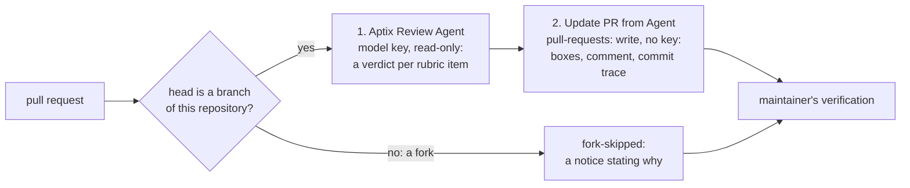

# Iris-Headers

This repository contains the Iris Digital Pathology public header files for all available modules(*see below*). These headers are not exhaustive; rather they allow for integration of the simplified public Iris application programming interface (API) without defining the internal stuctures within each module. These are the preferred headers if you wish to use Iris without compiling Iris modules individually.

Iris Digital Pathology API Modules:
  - IrisCore
  - IrisSlide
  - ~~IrisNetworking~~ (*not yet available -- internal use only*)
  - ~~IrisUserInterface~~ (*not yet available -- internal use only*)

Additionally, we provide access to some core internal components if you would like to link against them for ease of integrating with the Iris API. For example, Iris Buffers, designed for quick zero-copy data transfers and Iris Networking interfaces, can be linked against if you would like to wrap data or retrieve data in a way that is compatible with with Iris' internals. These optionally available components are set up as static libraries in the *CMakeLists.txt* configuration and are as follows:
  - IrisBuffers.cpp

## Incorporating this repository
**To use Iris Headers in your project** it is preferred that you use the CMake system and fetch this content:
```CMake 
FetchContent_Declare (
    IrisHeaders
    GIT_REPOSITORY https://github.com/IrisDigitalPathology/Iris-Headers.git
    GIT_TAG "origin/main"
    GIT_SHALLOW ON
)
FetchContent_MakeAvailable(IrisHeaders)
```
and included (without needing to add IrisHeaders to include_directories) as follows:
```CMake
target_link_libraries (
    YOUR_TARGET PUBLIC
    IrisHeaders # Use headers
    IrisBuffer  # (optional) Buffers
)
```

## Pull request review

Every pull request from a branch of this repository is reviewed by the Aptix governance review
bot against this repository's rules: `.github/review/rubric.toml` names the items and the files
they are judged against (`development/style_guide.md`, `development/ci_runners.md`,
`development/MODERNIZATION.md`, `development/ERRATA.md`), read from the default branch so a pull
request cannot change the rules it is judged by. The bot ticks the "Agent review" boxes of the
pull request template and posts one comment; a failed blocking item fails the `code-review`
check. A maintainer gives the final verification.



**Pull requests from forks get no model review.** The review runs on `pull_request_target`,
which gives a fork's pull request the repository's secrets and a write token, and anyone can open
one against a public repository; so both review jobs run only when the head is a branch of this
repository, and a fork's run shows a `fork-skipped` job whose notice states the reason. A
maintainer reviews a fork's change by hand, or pushes it to a branch here and opens a pull request
from that branch. `.github/workflows/review.yml` explains the design, and
`cmake/check_review_configuration.cmake` holds its safety properties in CI.
