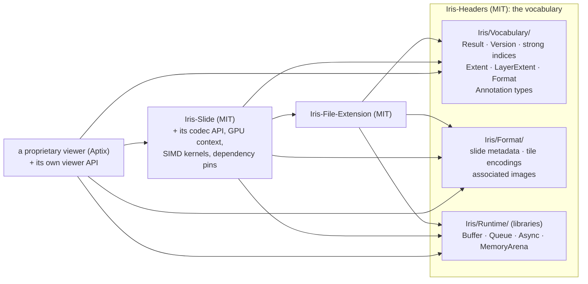
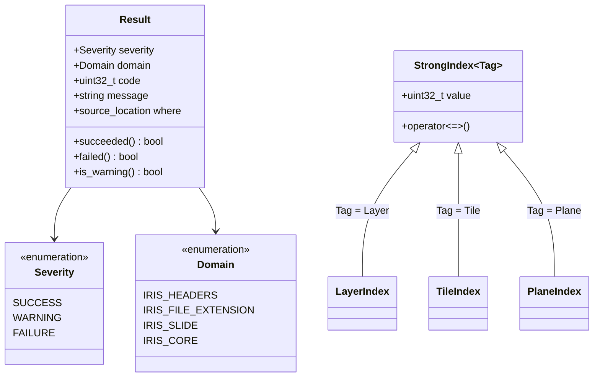

# ARCHITECTURE.md — Iris-Headers: the shared vocabulary of the Iris family

**Status:** decisions answered 2026-11-12 (§4); the plan is ready to build. ArenaClaimQuestion_9
decided 2026-11-26; ContributingPipelineQuestion_10 and LocalRulesQuestion_11 decided
2026-11-27; Questions 12 and 13 open. Its two diagrams render with mermaid-cli 12.2.0
(2026-11-12; rechecked 2026-11-26). **Owner:** the maintainer.

Decided 2026-11-12: any change Iris-Headers needs is allowed, because the
repository is being migrated to the most modern design it can take. Its purpose
is a common language shared by the open-source and proprietary projects that
depend on it.

**Renamed 2026-11-24 (decided: the open-source decoder and encoder of slide
files is named Iris-Slide, and the rename covers every repository):** the library is Iris-Slide, at `Aptix-Bio/Iris-Slide`. Its
headers are `IrisSlideCore.hpp` and `IrisSlideTypes.hpp`, its namespace
`IrisSlide`, its error codes `IrisSlide::SlideError` under
`Iris::Domain::IRIS_SLIDE`. The entries below dated before the rename keep the
file names and identifiers they were written with (`IrisCodecCore.hpp`,
`IrisCodecTypes.hpp`, `IrisCodec::`, `IRIS_CODEC`); their prose names the library Iris-Slide.

This document is the design contract: the purpose, what the repository held when the plan was
written, the target, and the decisions and open questions. The work that carries it out, the
requirements it implies and the record of mistakes and their guards are kept privately by the
maintainers (decided 2026-11-27, LocalRulesQuestion_11); their IDs appear here, in the code and in
pull requests. The rules a pull request is held to are [CONTRIBUTING.md](../CONTRIBUTING.md), and
the pipeline's are [PIPELINE.md](PIPELINE.md). Moved here on 2026-11-26 from the repository's
single plan file (DevelopmentLayout_7); git history keeps that file.

---

## 0. How to read this document

| Section | What it settles |
|---|---|
| §1 Purpose | what Iris-Headers is for, and which way its dependencies point |
| §2 What is there today | the findings of 2026-11-12, each with its evidence, and who includes what |
| §3 Target | the narrowed vocabulary (diagrams), what leaves and where it goes, what stays and how it is modernized |
| §4 Decisions and questions | every question with its dated answer, and the questions still open |

---

## 1. Purpose

Iris-Headers is the shared vocabulary of the Iris family: the types that the
open-source tools (Iris-File-Extension, Iris-Slide; MIT) and Aptix's
proprietary software all speak, so a `Result`, a `Buffer` or a tile
index means the same thing on both sides of a call. The dependency points one
way: proprietary code depends on this MIT repository, and nothing proprietary
flows into it.

That purpose is sound. What the repository holds today mixes it with three
other things, and its types predate the style rules the family now follows.
This plan narrows the repository to the vocabulary, modernizes those types,
and releases them by tag, without breaking a consumer at any step.

## 2. What is there today (read 2026-11-12, `ryanlandvater/Iris-Headers` at `0ba637d`)

| Finding | Evidence | Why it matters |
|---|---|---|
| **The old viewer API lives here.** `IrisCore.hpp` declares IrisV2's engine API: `create_viewer`, `viewer_open_slide`, `viewer_engine_translate`, `viewer_engine_zoom`, `viewer_annotate_slide`; `IrisTypes.hpp` holds their info structs and the `Viewer` and `Slide` handles | `include/IrisCore.hpp:37–117`, `include/IrisTypes.hpp:219–300, 353, 424–` | The viewer's API belongs to the viewer. The viewer replaced it with a lifecycle API plus bridge messages, so this copy is stale, and it places a product API in an MIT repository |
| **Engine and binding internals live here.** `priv/IrisCoreVulkan.hpp` includes Vulkan, MoltenVK and VMA headers; `priv/IrisCorePython.hpp` holds Python glue | `priv/IrisCoreVulkan.hpp`, `priv/IrisCorePython.hpp` | A vocabulary that pulls in a graphics API cannot be included by a consumer that does not use it |
| **The codec's API lives here.** `IrisCodecCore.hpp` and the handle part of `IrisCodecTypes.hpp` (`Context`, `Slide`, `Cache`, `Encoder`) are Iris-Slide's public API | `include/IrisCodecCore.hpp`, `include/IrisCodecTypes.hpp:46–82` | A codec API change forces a vocabulary release |
| **A name collision with a consumer.** `IrisCodecTypes.hpp` declares `Iris::Instance`, `Iris::Device` and `Iris::Queue` as `shared_ptr` aliases of IrisV2's internals; a proprietary consumer defines `Iris::Device` as a class | `include/IrisCodecTypes.hpp:31–35` | That consumer cannot include the codec's headers for its CPU decode path |
| **Other repositories' version pins live here.** `cmake/dependencies.cmake` pins the Vulkan SDK, VMA, GLM, pybind11, Highway, zlib-ng, libpng, libjpeg-turbo, libavif, libdicom and OpenSlide for every consumer | `cmake/dependencies.cmake` | Every one of those is Iris-Slide's dependency (Highway also serves `IrisSIMD.cpp`); bumping one releases the vocabulary |
| **Weak types.** `LayerIndex`, `TileIndex` and `ImageIndex` are all `uint32_t` aliases, so one passes where another is expected without a diagnostic | `include/IrisTypes.hpp:105–107` | The family's style guide requires strong index types (Typing) |
| **`Result` is a flag and a string.** An unscoped `ResultFlag` bit field; conversion to `bool` is true for a warning; `operator==` against `bool`; the default constructor is not `noexcept`; parameters named `__f` and `__s` | `include/IrisTypes.hpp:113–164` | The family's errors carry a domain, a code, the offending value and the place of failure (style guide, Errors); identifiers with a double underscore are reserved to the implementation in C++ |
| **`IRIS_EXPORT` has two states where it needs three** (exporting, importing, static); unscoped `enum IRIS_EXPORT` declarations, where the attribute has no effect | IFE's notes to this repository, item 5; `include/IrisTypes.hpp:113` | `LNK2019` and `C2491` on Windows static builds, which IFE works around |
| **Inconsistent naming and guards.** `Create_strong_buffer`, `Wrap_weak_buffer_fom_data` (sic) beside snake_case; guards `IrisQueueV2_h`, `IrisBuffer_hpp` | `include/IrisCore.hpp:159–250`; the maintainer's working notes | The family style guide: `snake_case` functions |
| **No releases, two homes.** No tags; `IrisDigitalPathology/Iris-Headers` (the canonical repository, `5e91221`) and `ryanlandvater/Iris-Headers` (the development fork, 7 commits ahead) diverge; consumers fetch `main` | `git tag` empty; `cmake/dependencies.cmake` header ("track their owner's tips"); IFE `CMakeLists.txt:84–120` | A consumer cannot pin a release; one consumer pins the fork's commit today |
| **No CI.** Nothing compiles these headers, alone or against a consumer | the downstream-drift sketch in the maintainer's working notes | Every change below needs a safety net first |
| **Open format facts from IFE 1.1** (from IFE's notes to this repository, a working file kept outside it; each fact is restated here). `LayerExtent::zPlanes`, `Metadata::micronsPerPlane`, the clinical metadata range, and the `UASTC`, `XUASTC`, `AV1` encodings | IFE's notes to this repository, item 1–3 | Parked as workarounds in IFE |

Who includes what, today:

| Header | IFE | Iris-Slide | A proprietary consumer (planned) |
|---|---|---|---|
| `IrisTypes.hpp` (`Result`, `Buffer` handle, extents, annotations, formats) | yes | yes | yes |
| `IrisSlideTypes.hpp` (slide metadata, encodings, images; codec handles; the encoder's `EncoderDesc` and `EncoderProgress`) | yes | yes | for its CPU decode path |
| `IrisSlideCore.hpp` (Iris-Slide's API, the encoder's included) | — | yes | for its CPU decode path |
| `IrisCore.hpp` (IrisV2 viewer API, Buffer functions) | — | yes (Buffer functions) | — |
| `priv/IrisBuffer.hpp`, `IrisQueue.hpp`, `IrisAsync.hpp` | — | yes | yes |
| `priv/IrisMemory.hpp` | yes | — | — |
| `priv/IrisSIMD.hpp` | — | yes | — |
| `priv/IrisCoreVulkan.hpp`, `IrisCorePython.hpp` | — | `IrisCoreVulkan.hpp` | — |

## 3. Target

What leaves, and where it goes:

| Leaves | Goes to | Because |
|---|---|---|
| `IrisCore.hpp` viewer API, viewer info structs, `Viewer` and `Slide` handles | the viewer's own repository (rewritten to its lifecycle API), deleted here | the viewer owns its API |
| `priv/IrisCoreVulkan.hpp`, `priv/IrisCorePython.hpp` | Iris-Slide (its GPU context) and the viewer (its bindings), whichever still needs them | engine and binding internals |
| Codec handles and API (`Context`, `Slide`, `Cache`, `Encoder`, `IrisCodecCore.hpp`) and the `Iris::Instance` / `Device` / `Queue` aliases | Iris-Slide, under `IrisCodec::` | removes the collision with a consumer's `Iris::Device` class |
| `cmake/dependencies.cmake`, `priv/IrisSIMD.hpp`, `src/IrisSIMD.cpp` | Iris-Slide | they are the codec's dependencies and kernels |

What stays, modernized:

- **`Result`** (ResultShapeQuestion_3, answered): a scoped `Severity` replaces the bit field;
  `Domain` says which project's code it is (its members are those of `include/IrisTypes.hpp`),
  and `code` is that project's own
  error enumeration, so each consumer keeps its own error families and the codec keeps its own
  without this repository knowing either;
  `message` carries the offending value; `where` is a `std::source_location`
  filled at the failure. `[[nodiscard]]` on every function returning it, no
  conversion to `bool` (callers write `succeeded()` or `failed()`), every
  member `noexcept`. `std::expected` would be the natural carrier for a value
  or an error, but it needs C++23 and the family builds C++20 (measured
  2026-11-12: Apple clang 21 defines `__cpp_lib_expected` only under
  `-std=c++23`); a consumer's completions already pass `(Result, T)`.
- **Strong indices**: one `StrongIndex<Tag>` template, so `LayerIndex`,
  `TileIndex`, `PlaneIndex` and `ImageIndex` cannot be mixed; the raw number
  only at the wire, through `value`.
- **Scoped enumerations** for `Format`, `AnnotationTypes`, `Encoding`,
  `MetadataType`, `ImageEncoding`, `ImageOrientation`, and the generated
  constants named from IFE's `spec/ife_constants.json`, so the file format
  stays the one source of each value (the style guide's named-values rule).
- **`IRIS_EXPORT` with three states** (export, import, static), as IFE's
  `IFE_Export.hpp` already does; no export attribute on an enumeration.
- **Libraries instead of loose sources**: `Buffer`, `Queue`, `Async` and
  `MemoryArena` become static library targets in CMake and Bazel
  (`iris_headers_runtime`), so a consumer links them instead of compiling
  `src/*.cpp` itself (the `README.md` already promises this).
- **The arena's claim** (ArenaClaimQuestion_9, decided 2026-11-26): `MemoryArena` regains the
  write head and the compare-and-swap claim of a slice that were left behind when it was
  extracted from FastFHIR's arena, and the stream head for streams of unknown length, so every
  Iris repository that writes into an arena claims through one routine (ArenaClaim_8).
- **Layout** under `include/Iris/` with `#pragma once`, one header per type
  family, `snake_case` functions, no reserved identifiers.

## 4. Decisions and questions

Each question has a proposal and its dated answer; the last column names the work that carries
it out (an item of the work breakdown, kept privately). An answer changes only by a dated
amendment in its row.

| Q | Question | Proposal | WBS |
|---|---|---|---|
| VocabularyScopeQuestion_1 | Narrow Iris-Headers to the shared vocabulary (§3), moving the viewer API to the viewer and the codec API, GPU context, SIMD kernels and dependency pins to Iris-Slide? | **Answered 2026-11-12: narrow it**, as proposed. Only the common language stays, so a change to one project's API never releases the others' vocabulary | Narrow_3 |
| CanonicalHomeQuestion_2 | Which repository is canonical, and how are releases made? | Proposed: the IrisDigitalPathology repository canonical, transfer to Aptix later. **Answered 2026-11-12: move to Aptix now**, before the first tag, and keep it **public under MIT** (follow-up, same day), so IFE, Iris-Slide and community users fetch it without credentials and nothing proprietary enters it. `Aptix-Bio/Iris-Headers` becomes canonical; `ryanlandvater/Iris-Headers` stays the development fork that IFE's fork-mirroring fetches; releases are signed SemVer tags on `Aptix-Bio/Iris-Headers`, and each consumer pins a tag and its hash. A transfer redirects the old URL for links, `git clone`, `fetch` and `push`, until a repository is created at the old location, which deletes the redirect ([GitHub, transferring a repository](https://docs.github.com/en/repositories/creating-and-managing-repositories/transferring-a-repository), read 2026-11-12); so nothing is ever created at `IrisDigitalPathology/Iris-Headers` again, and consumers move to the new URL in their next pull request | Release_2 |
| ResultShapeQuestion_3 | `Result`'s new shape: `Severity` + `Domain` + project code + message + `source_location` (§3)? | **Answered 2026-11-12: as proposed**, with `succeeded()` / `failed()` and no conversion to `bool`, `[[nodiscard]]`, every member `noexcept` | ResultRedesigned_4.1 |
| BreakingReleaseQuestion_4 | One breaking release (2.0.0) with every consumer moved in step, or a release that deprecates first and removes in the next? | **Answered 2026-11-12: one breaking release**, as proposed; the downstream build (SafetyNet_1) proves each consumer before the tag, and no deprecation shim is written | BreakingRelease_6.1 |
| StrongIndicesQuestion_5 | Strong indices for `LayerIndex`, `TileIndex`, `ImageIndex`, plus `PlaneIndex` (Z-stacks)? | **Answered 2026-11-12: strong indices**, one `StrongIndex<Tag>` template, as proposed; IFE's generator emits them | StrongIndices_4.2 |
| MemoryArenaQuestion_6 | Does `MemoryArena` (from FastFHIR) stay here? | **Answered 2026-11-12: it stays**, in the `iris_headers_runtime` library with Buffer, Queue and Async, since IFE and Iris-Slide both need it and IFE cannot depend on the codec | RuntimeLibraries_4.5 |
| TileEncodingAv1Question_7 | What does tile encoding value 3 hold, AVIF or AV1? | **Decided 2026-11-25: AV1.** `TILE_ENCODING_AVIF = 3` becomes `TILE_ENCODING_AV1 = 3`: a bare AV1 sequence in the Low Overhead Bitstream Format of the [AV1 bitstream specification](https://aomediacodec.github.io/av1-spec/) (read 2026-11-25), one shown frame per focal plane, a single-plane tile one key frame, with no container. `CACHE_ENCODING_AVIF` follows as `CACHE_ENCODING_AV1`, since a cache entry holds a tile in a tile encoding. No .iris file in use carries AVIF tiles, so the value is reassigned without an alias. `IMAGE_ENCODING_AVIF` (associated images) and the libavif pin stay. IFE makes the matching spec change | TileEncodingAv1_5.4.1 |
| TileEncodingBlocksQuestion_8 | Which values hold the GPU block-compressed tile encodings, and does the cache mirror them? | **Decided 2026-11-25: `TILE_ENCODING_UASTC = 4` and `TILE_ENCODING_XUASTC = 5`**, after AV1, matching IFE's `tile_encodings` 1.1. Each tile byte-stream is bare: under UASTC one Zstandard frame of the tile's 16-byte UASTC LDR 4x4 blocks in raster order ([UASTC LDR 4x4 specification](https://github.com/BinomialLLC/basis_universal/wiki/UASTC-LDR-4x4-Texture-Specification), [RFC 8878](https://www.rfc-editor.org/rfc/rfc8878)); under XUASTC one XUASTC LDR bitstream ([XUASTC LDR specification v1.0](https://github.com/BinomialLLC/basis_universal/wiki/XUASTC-LDR-Specification-v1.0), marked preliminary by its authors); one plane and one mip level each, all read 2026-11-25. **The cache does not mirror them:** `CACHE_ENCODING_LZ` and `CACHE_ENCODING_NO_COMPRESSION` already hold 4 and 5, and mirroring would renumber both; whether the cache needs block-compressed members is Iris-Slide's. IFE owns the open items: where a stream records its mip levels, XUASTC's footprint and its bitstream's stability | TileEncodingBlocks_5.4.2 |
| ArenaClaimQuestion_9 | Do the arena's write head and its claim of a slice return to Iris-Headers? | **Decided 2026-11-26: yes, beside `Iris::Memory`** (`priv/IrisMemory.hpp`), complete enough that no Iris repository reads FastFHIR for it: the write head, the compare-and-swap claim of a slice (load, bounds check, compare-and-swap, commit) and its commit, ported from FastFHIR's arena (`Memory_t::claim_space`), which `MemoryArena` was extracted from without them (`src/IrisMemory.cpp:12`). The stream head (`Memory::StreamHead`, for streams of unknown length) is ported too. Its readers: a slide reader that reserves a range reply's known length before sending the request, so every request in flight writes into its own slice and no writer waits; and IFE's Builder, which claims through it in place of its own bump (`Builder_t::claim`). One change in the port: FastFHIR's `claim_space` parks every other claimer on the stream's lock bit (`head.wait`, FastFHIR `src/FF_memory.cpp:413-444`), which the style guide's rule that nothing on a hot path waits forbids, so a claim made while a stream holds the head fails at once with a named result and the claimer moves on; that change is confirmed at ArenaClaim_8's VERIFY | ArenaClaim_8 |
| ContributingPipelineQuestion_10 | Does Iris-Headers gain a `CONTRIBUTING.md` and a `development/PIPELINE.md`? | Its pipeline facts (the workflows, the `cmake -P` scripts, the settings `trigger-downstream` needs, the review workflow's safety properties) were spread over the comments of `.github/workflows/` and `cmake/` and the work breakdown. Proposed: write both in one later package, `PIPELINE.md` as numbered rules taken from those comments, `CONTRIBUTING.md` as this repository's own rules. **Decided 2026-11-27: both, written in DevelopmentLayout_7**, so that a contributor reads this repository's own rules in it while the family's general conventions are kept privately: [CONTRIBUTING.md](../CONTRIBUTING.md) holds the rules a pull request is held to, numbered, as facts of this codebase, and [PIPELINE.md](PIPELINE.md) the pipeline's numbered rules | PlansPrivate_7.4 |
| LocalRulesQuestion_11 | Do `development/style_guide.md` and `development/ci_runners.md` stay in this repository? | The review bot read only files of this repository (`.github/review/rubric.toml`, `reference_files`), and these two were its copy of the family's rules, adopted 2026-11-24. **Decided 2026-11-27: both leave this repository**, so that a public repository carries no copy of the family's internal development rules; they are removed in the pull request that moves the review bot's pin to a bot that loads the shared rules from its own private checkout, and they stay until then because the rubric's `reference_files` names them and the bot fails a review when one is missing. *Amended 2026-11-27:* they are removed in DevelopmentLayout_7, and the work breakdown, the requirement rows and the errata leave with them, kept privately with the family's conventions; the rubric names the shared rules and those three files by file name alone (`shared_reference_files`, `plan_reference_files`, `plan_excerpt_files`), and the bot's pin moves to the bot that reads them in the same pull request | PlansPrivate_7.4 |

### Open questions

| Q | Question | Facts | Proposal | WBS |
|---|---|---|---|---|
| ArenaClaimAlignmentQuestion_12 | Does the claim take an alignment? | A slide reader's storage policies align a reply's slice (4 KiB pages; whole sectors for Windows unbuffered reads); FastFHIR's `claim_space(bytes)` and IFE's `Builder_t::claim(bytes)` take a size only | Not proposed here; settled before WriteHeadClaim_8.1's red step | ArenaClaim_8 |
| ArenaHeadPlacementQuestion_13 | Where does the write head live? | FastFHIR keeps it inside the mapping (`m_head_ptr`, the arena's first bytes, so a file-backed arena carries its own head); IFE's Builder keeps it as a member atomic beside its `Iris::Memory`; `Iris::Memory` reserves no header bytes today | Not proposed here; settled before WriteHeadClaim_8.1's red step | ArenaClaim_8 |
