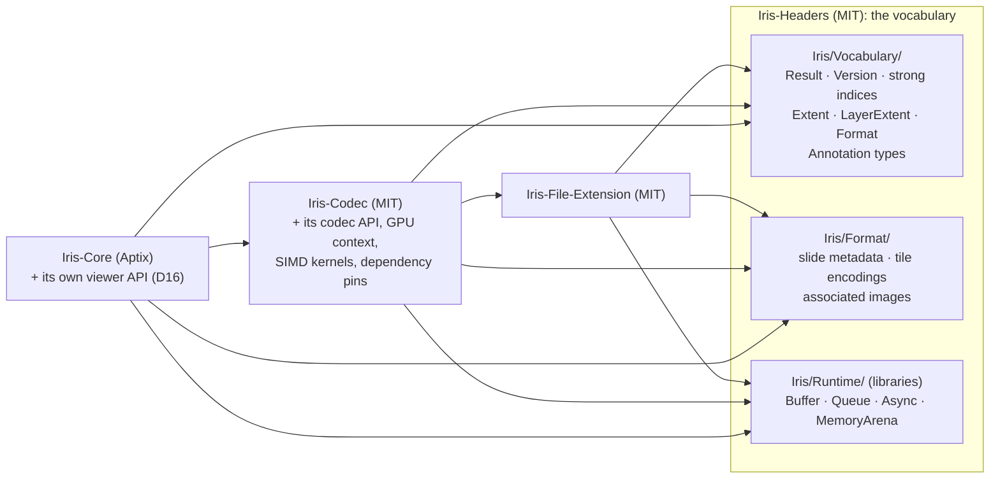
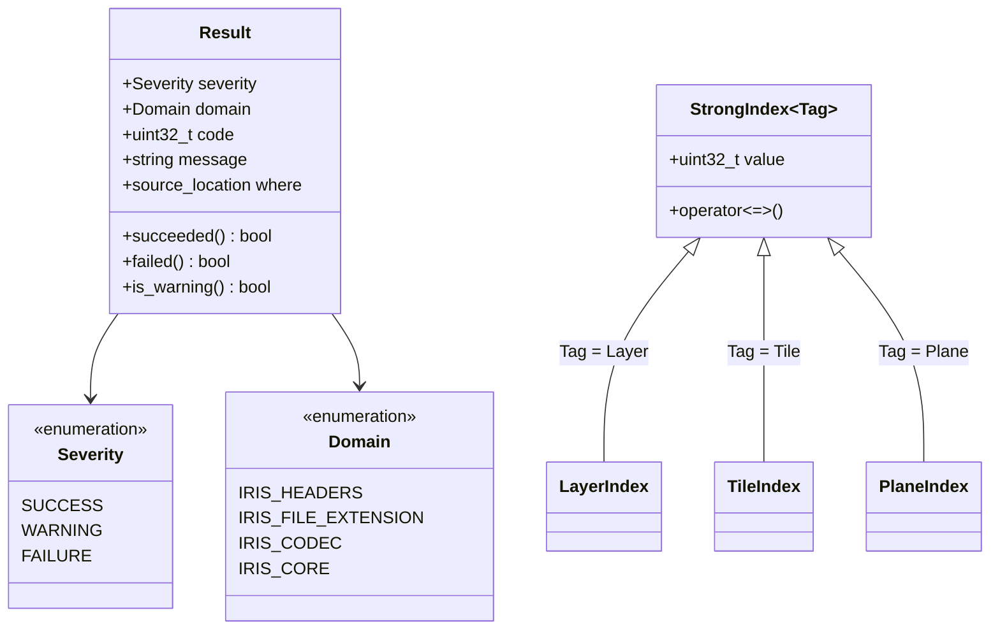
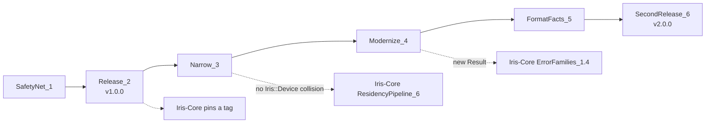

# Iris-Headers modernization plan

**Status:** decisions answered 2026-11-12 (§4); the plan is ready to build.
Its three diagrams render with mermaid-cli 12.2.0 (2026-11-12). **Owner:** Ryan.

Ryan, 2026-11-12: "Any changes that are needed to the upstream Iris-Headers are
allowed. We are migrating this project to as modern a design architecture as we
can." And on its purpose: "I wanted to ensure both open source and proprietary
projects share a common language."

## 1. Purpose

Iris-Headers is the shared vocabulary of the Iris family: the types that the
open-source tools (Iris-File-Extension, Iris-Codec; MIT) and Aptix's
proprietary engine (Iris-Core) all speak, so a `Result`, a `Buffer` or a tile
index means the same thing on both sides of a call. The dependency points one
way: proprietary code depends on this MIT repository, and nothing proprietary
flows into it (Iris-Core ARCHITECTURE D20).

That purpose is sound. What the repository holds today mixes it with three
other things, and its types predate the style rules the family now follows.
This plan narrows the repository to the vocabulary, modernizes those types,
and releases them by tag, without breaking a consumer at any step.

## 2. What is there today (read 2026-11-12, `ryanlandvater/Iris-Headers` at `0ba637d`)

| Finding | Evidence | Why it matters |
|---|---|---|
| **The old viewer API lives here.** `IrisCore.hpp` declares IrisV2's engine API: `create_viewer`, `viewer_open_slide`, `viewer_engine_translate`, `viewer_engine_zoom`, `viewer_annotate_slide`; `IrisTypes.hpp` holds their info structs and the `Viewer` and `Slide` handles | `include/IrisCore.hpp:37–117`, `include/IrisTypes.hpp:219–300, 353, 424–` | The engine's API belongs to the engine. Iris-Core replaced it with a lifecycle API plus bridge messages (Iris-Core D16), so this copy is stale, and it places a product API in an MIT repository |
| **Engine and binding internals live here.** `priv/IrisCoreVulkan.hpp` includes Vulkan, MoltenVK and VMA headers; `priv/IrisCorePython.hpp` holds Python glue | `priv/IrisCoreVulkan.hpp`, `priv/IrisCorePython.hpp` | A vocabulary that pulls in a graphics API cannot be included by a consumer that does not use it |
| **The codec's API lives here.** `IrisCodecCore.hpp` and the handle part of `IrisCodecTypes.hpp` (`Context`, `Slide`, `Cache`, `Encoder`) are Iris-Codec's public API | `include/IrisCodecCore.hpp`, `include/IrisCodecTypes.hpp:46–82` | A codec API change forces a vocabulary release |
| **A name collision with Iris-Core.** `IrisCodecTypes.hpp` declares `Iris::Instance`, `Iris::Device` and `Iris::Queue` as `shared_ptr` aliases of IrisV2's internals; Iris-Core's RIG defines `Iris::Device` as a class (Iris-Core D2) | `include/IrisCodecTypes.hpp:31–35` | Iris-Core cannot include the codec's headers for its CPU decode path (Iris-Core ResidencyPipeline_6) |
| **Other repositories' version pins live here.** `cmake/dependencies.cmake` pins the Vulkan SDK, VMA, GLM, pybind11, Highway, zlib-ng, libpng, libjpeg-turbo, libavif, libdicom and OpenSlide for every consumer | `cmake/dependencies.cmake` | Every one of those is Iris-Codec's dependency (Highway also serves `IrisSIMD.cpp`); bumping one releases the vocabulary |
| **Weak types.** `LayerIndex`, `TileIndex` and `ImageIndex` are all `uint32_t` aliases, so one passes where another is expected without a diagnostic | `include/IrisTypes.hpp:105–107` | Iris-Core requires strong index types (its ARCHITECTURE §6) |
| **`Result` is a flag and a string.** An unscoped `ResultFlag` bit field; conversion to `bool` is true for a warning; `operator==` against `bool`; the default constructor is not `noexcept`; parameters named `__f` and `__s` | `include/IrisTypes.hpp:113–164` | Iris-Core's errors carry a family, a code, the offending value and the place of failure (its ARCHITECTURE §6); identifiers with a double underscore are reserved to the implementation in C++ |
| **`IRIS_EXPORT` has two states where it needs three** (exporting, importing, static); unscoped `enum IRIS_EXPORT` declarations, where the attribute has no effect | IFE's notes to this repository, item 5; `include/IrisTypes.hpp:113` | `LNK2019` and `C2491` on Windows static builds, which IFE works around |
| **Inconsistent naming and guards.** `Create_strong_buffer`, `Wrap_weak_buffer_fom_data` (sic) beside snake_case; guards `IrisQueueV2_h`, `IrisBuffer_hpp` | `include/IrisCore.hpp:159–250`; Ryan's working notes | The family style guide: `snake_case` functions |
| **No releases, two homes.** No tags; `IrisDigitalPathology/Iris-Headers` (the canonical repository, `5e91221`) and `ryanlandvater/Iris-Headers` (the development fork, 7 commits ahead) diverge; consumers fetch `main` | `git tag` empty; `cmake/dependencies.cmake` header ("track their owner's tips"); IFE `CMakeLists.txt:84–120` | A consumer cannot pin a release; Iris-Core pins the fork's commit today |
| **No CI.** Nothing compiles these headers, alone or against a consumer | the downstream-drift sketch in Ryan's working notes | Every change below needs a safety net first |
| **Open format facts from IFE 1.1** (from IFE's notes to this repository, a working file kept outside it; each fact is restated here). `LayerExtent::zPlanes`, `Metadata::micronsPerPlane`, the clinical metadata range, and (Iris-Core D22) the `UASTC`, `XUASTC`, `AV1` encodings | IFE's notes to this repository, item 1–3; Iris-Core ExternalDependencies_0.4.1 | Parked as workarounds in IFE |

Who includes what, today:

| Header | IFE | Iris-Codec | Iris-Core (planned) |
|---|---|---|---|
| `IrisTypes.hpp` (`Result`, `Buffer` handle, extents, annotations, formats) | yes | yes | yes |
| `IrisCodecTypes.hpp` (slide metadata, encodings, images; codec handles) | yes | yes | from ResidencyPipeline_6 |
| `IrisCodecCore.hpp` (codec API) | — | yes | from ResidencyPipeline_6 |
| `IrisCore.hpp` (IrisV2 viewer API, Buffer functions) | — | yes (Buffer functions) | — |
| `priv/IrisBuffer.hpp`, `IrisQueue.hpp`, `IrisAsync.hpp` | — | yes | yes (Iris-Core D1) |
| `priv/IrisMemory.hpp` | yes | — | — |
| `priv/IrisSIMD.hpp` | — | yes | — |
| `priv/IrisCoreVulkan.hpp`, `IrisCorePython.hpp` | — | `IrisCoreVulkan.hpp` | — |

## 3. Target

What leaves, and where it goes:

| Leaves | Goes to | Because |
|---|---|---|
| `IrisCore.hpp` viewer API, viewer info structs, `Viewer` and `Slide` handles | Iris-Core `include/Iris/Core/` (rewritten to its D16 lifecycle), deleted here | the engine owns its API |
| `priv/IrisCoreVulkan.hpp`, `priv/IrisCorePython.hpp` | Iris-Codec (its GPU context) and Iris-Core (its bindings), whichever still needs them | engine and binding internals |
| Codec handles and API (`Context`, `Slide`, `Cache`, `Encoder`, `IrisCodecCore.hpp`) and the `Iris::Instance` / `Device` / `Queue` aliases | Iris-Codec, under `IrisCodec::` | removes the collision with Iris-Core's `Iris::Device` |
| `cmake/dependencies.cmake`, `priv/IrisSIMD.hpp`, `src/IrisSIMD.cpp` | Iris-Codec | they are the codec's dependencies and kernels |

What stays, modernized:

- **`Result`** (ResultShapeQuestion_3, answered): a scoped `Severity` replaces the bit field;
  `Domain` says which project's code it is, and `code` is that project's own
  error enumeration, so Iris-Core keeps its error families (its ARCHITECTURE
  §6) and the codec keeps its own without this repository knowing either;
  `message` carries the offending value; `where` is a `std::source_location`
  filled at the failure. `[[nodiscard]]` on every function returning it, no
  conversion to `bool` (callers write `succeeded()` or `failed()`), every
  member `noexcept`. `std::expected` would be the natural carrier for a value
  or an error, but it needs C++23 and the family builds C++20 (measured
  2026-11-12: Apple clang 21 defines `__cpp_lib_expected` only under
  `-std=c++23`); Iris-Core's completions already pass `(Result, T)` (its D13).
- **Strong indices**: one `StrongIndex<Tag>` template, so `LayerIndex`,
  `TileIndex`, `PlaneIndex` and `ImageIndex` cannot be mixed; the raw number
  only at the wire, through `value`.
- **Scoped enumerations** for `Format`, `AnnotationTypes`, `Encoding`,
  `MetadataType`, `ImageEncoding`, `ImageOrientation`, and the generated
  constants named from IFE's `spec/ife_constants.json`, so the file format
  stays the one source of each value (Arbiter's "named values" rule).
- **`IRIS_EXPORT` with three states** (export, import, static), as IFE's
  `IFE_Export.hpp` already does; no export attribute on an enumeration.
- **Libraries instead of loose sources**: `Buffer`, `Queue`, `Async` and
  `MemoryArena` become static library targets in CMake and Bazel
  (`iris_headers_runtime`), so a consumer links them instead of compiling
  `src/*.cpp` itself (the `README.md` already promises this).
- **Layout** under `include/Iris/` with `#pragma once`, one header per type
  family, `snake_case` functions, no reserved identifiers.

## 4. Decisions for Ryan

Each question has a proposal and Ryan's dated answer.

| Q | Question | Proposal |
|---|---|---|
| VocabularyScopeQuestion_1 | Narrow Iris-Headers to the shared vocabulary (§3), moving the viewer API to Iris-Core and the codec API, GPU context, SIMD kernels and dependency pins to Iris-Codec? | **Answered 2026-11-12 (Ryan): narrow it**, as proposed. Only the common language stays, so a change to one project's API never releases the others' vocabulary |
| CanonicalHomeQuestion_2 | Which repository is canonical, and how are releases made? | Proposed: the IrisDigitalPathology repository canonical, transfer to Aptix later. **Answered 2026-11-12 (Ryan): move to Aptix now**, before the first tag, and keep it **public under MIT** (follow-up, same day), so IFE, Iris-Codec and community users fetch it without credentials and nothing proprietary enters it (Iris-Core D20). `Aptix-Bio/Iris-Headers` becomes canonical; `ryanlandvater/Iris-Headers` stays the development fork that IFE's fork-mirroring fetches; releases are signed SemVer tags on `Aptix-Bio/Iris-Headers`, and Iris-Core pins a tag and its hash. A transfer redirects the old URL for links, `git clone`, `fetch` and `push`, until a repository is created at the old location, which deletes the redirect ([GitHub, transferring a repository](https://docs.github.com/en/repositories/creating-and-managing-repositories/transferring-a-repository), read 2026-11-12); so nothing is ever created at `IrisDigitalPathology/Iris-Headers` again, and consumers move to the new URL in their next pull request |
| ResultShapeQuestion_3 | `Result`'s new shape: `Severity` + `Domain` + project code + message + `source_location` (§3)? | **Answered 2026-11-12 (Ryan): as proposed**, with `succeeded()` / `failed()` and no conversion to `bool`, `[[nodiscard]]`, every member `noexcept` |
| BreakingReleaseQuestion_4 | One breaking release (2.0.0) with every consumer moved in step, or a release that deprecates first and removes in the next? | **Answered 2026-11-12 (Ryan): one breaking release**, as proposed; the downstream build (SafetyNet_1) proves each consumer before the tag, and no deprecation shim is written |
| StrongIndicesQuestion_5 | Strong indices for `LayerIndex`, `TileIndex`, `ImageIndex`, plus `PlaneIndex` (Z-stacks)? | **Answered 2026-11-12 (Ryan): strong indices**, one `StrongIndex<Tag>` template, as proposed; IFE's generator emits them |
| MemoryArenaQuestion_6 | Does `MemoryArena` (from FastFHIR) stay here? | **Answered 2026-11-12 (Ryan): it stays**, in the `iris_headers_runtime` library with Buffer, Queue and Async, since IFE and Iris-Codec both need it and IFE cannot depend on the codec |

## 5. Work breakdown

Names follow the family's convention (phase → work package → task → steps;
spelled-out names; evidence on every tick). Each phase leaves every consumer
building.

### SafetyNet_1 — nothing changes without a consumer proving it

- [ ] **VERIFY:** **StandaloneHeaderBuild_1.1** — every public header compiles alone and all together in one translation unit, on Linux, macOS and Windows, with Clang (Iris-Core D38). Evidence: `cmake/standalone_headers.cmake` (on when top-level); red first: `IrisAsync`, `IrisBuffer`, `IrisQueue`, `IrisSIMD` failed alone (they relied on earlier includes); each now includes what it uses; green with Apple clang 21 (2026-11-12, `5f0d36f`). `IrisCorePython.hpp` (includes IrisV2's missing `IrisCorePriv.hpp`) and `IrisCoreVulkan.hpp` (needs Vulkan and VMA) excluded until Narrow_3 removes them. owes a green run of `downstream.yml`'s Linux, macOS and Windows cells (the Windows cell added after review)
- [ ] **DownstreamBuild_1.2** — IFE and Iris-Codec built and tested against this checkout through `FETCHCONTENT_SOURCE_DIR_IRISHEADERS`, with the control run against the base so a consumer already red does not block; and, when a pull request merges, each consumer's own CI started against the merge commit (Ryan, 2026-11-12: "we should make sure to trigger downstream dependency repos CIs as well"; "Only for closing PRs")
  - [x] Proven locally first. Evidence (2026-11-12, Apple clang 21): IFE (the development fork's `d90f458`) against this checkout 24/24 tests (CI builds the organization's tip instead); the Iris-Codec decoder builds and links (it has no tests in that configuration). Both first failed for a reason outside Iris-Headers: Anaconda first on the Mac's PATH, whose old `nm` rejects `-C` (IFE `ife_exported_symbols`) and whose `libturbojpeg.0.4.0` was linked against libjpeg-turbo 3.2.1 headers (Codec, `_tj3InitVersion`); the control build of Codec against unchanged headers failed identically (red/red). IFE's test finds `nm` with `find_program` at test time, so that test depends on PATH order *(worth fixing in IFE)*
  - [x] `.github/workflows/downstream.yml`: on pull requests and pushes to `main`, IFE (tested; Linux, macOS, Windows through ClangCL) and the Codec decoder (Linux, macOS), against the change and then the base; no secret. `.github/workflows/trigger-downstream.yml`: on a push to `main` that GitHub associates with a merged pull request, `workflow_dispatch` of IFE `ci.yml` and Codec's three CMake CI workflows with `iris_headers_ref` set to the merge commit, through a GitHub App token limited to Actions write (which starts runs and cannot push code; `repository_dispatch` would need Contents write, and reading a commit's pull requests needs Pull requests read: [Permissions required for GitHub Apps](https://docs.github.com/en/rest/authentication/permissions-required-for-github-apps), read 2026-11-12); running on `push` instead of `pull_request_target` keeps every input trusted. Actions pinned by SHA (`actions/checkout` v7.0.1, `actions/create-github-app-token` v3.3.0, latest releases on 2026-11-12). Evidence: actionlint clean; zizmor 1.32.0 no findings (`726726a`). **Revised after review (2026-11-12):** the first run showed two cells passing while building nothing (IFE on Windows could not find the Visual Studio 2022 generator; the Codec on Linux lacked Meson), because red against both passed. A configure failure now fails the cell as broken tooling, and red against both warns only after a successful configure; Windows uses the default Visual Studio generator with ClangCL; Meson is installed; the Codec fetches IFE from `IrisDigitalPathology` (`IRIS_DEPS_OWNER`); every job has `contents: read`; the standalone-header check gains a Windows cell, and a type-test job runs TypeTests_1.3 on all three systems. Owes a green run
  - [ ] A GitHub App with Actions write only, installed on IFE and Iris-Codec (and Iris-Core once it is a consumer); its client ID as `DOWNSTREAM_APP_CLIENT_ID` (the pinned action deprecates the app ID) and key as `DOWNSTREAM_APP_PRIVATE_KEY` in a `downstream-dispatch` environment deployable from `main` only. Ryan creates it
  - [ ] IFE `ci.yml` and Codec's `cmake-*-CI.yml` accept `workflow_dispatch` with an `iris_headers_ref` input and build against that commit; changed in those repositories
  - [ ] Iris-Core added as a third consumer once its `feature/Scaffold_1` merges; after TransferredToAptix_2.3 the workflows name the new owner
  - [ ] Both workflows green on GitHub, and a merge seen to start each consumer's run
- [x] **TypeTests_1.3** — Catch2 tests for today's `Result`, `Buffer`, `IrisQueue`, `Async` and `MemoryArena` behaviour, so the rewrite in Modernize_4 is checked against what consumers rely on. Evidence: `tests/types_test.cpp` (`IRIS_HEADERS_BUILD_TYPE_TESTS`, Catch2 3.15.1 at Iris-Core's hash): 10 tests, 100% under ctest; the queue tests 8 of 8 runs stable (2026-11-12). Run in CI by `downstream.yml`'s type-test job (added after review). These record existing behaviour, so no red-before-green step applies; each new expectation in Modernize_4 is written red first. Found while writing them:
  - `IrisCore.hpp` declares `Buffer_change_strength`, which nothing defines, and `Buffer_write_into_buffer(const Buffer&, size_t)`, while `src/IrisBuffer.cpp` defines a `(Buffer&, size_t&)` overload; neither declared function can be called. No consumer calls them. Fixed in RuntimeLibraries_4.5
  - `FIFO2::Queue::begin()` returns an iterator at the newest node, so an iterator taken after a backlog longer than one node (2048 entries) misses the earlier nodes: 4096 pushed, 2048 popped (2048–4095). `IrisAsync` is safe only because its workers take `begin()` before any task is pushed. Recorded as a `[!shouldfail]` test; fixed in IteratorFromOldestNode_4.8
  - `Async`'s thread pool, found by the Windows type-test cell (0 of 100 tasks run) and reproduced on macOS by a 300-round test, red first: a worker that had not reached its loop when `wait_until_complete` began draining never ran anything; the drain's wake-up could be missed, costing up to a second per worker; and `issue_task` counted a task after publishing it, so a worker's earlier decrement was clamped away and `pending_tasks()` stayed 1. Fixed in `src/IrisAsync.cpp`: workers run what is queued before checking the status, the status changes under the workers' mutex with a predicate wait, and a task is counted before it is published; 100 of 100 local runs pass. A missed notification of a newly issued task still waits up to a second, unchanged and left to Modernize_4

### Release_2 — a version consumers can pin

- [ ] **ForksReconciled_2.1** — the fork's 7 commits (`2f6e777` … `0ba637d`) merged into `IrisDigitalPathology/Iris-Headers` by pull request, so the transfer carries one history
- [ ] **TransferredToAptix_2.3** — Ryan transfers `IrisDigitalPathology/Iris-Headers` to `Aptix-Bio`, public, MIT unchanged (CanonicalHomeQuestion_2); the old URL redirects; IFE's fork-mirroring and Iris-Codec's `cmake/iris-repositories.cmake` name `Aptix-Bio` as the canonical owner; nothing is created at the old location
- [ ] **FirstTag_2.2** — `v1.0.0`, signed, on `Aptix-Bio/Iris-Headers` after TransferredToAptix_2.3, matching `MODULE.bazel`'s version; Iris-Core's pin moved from `0ba637d` to it (Iris-Core IrisHeadersRelease_0.4.9)

### Narrow_3 — only the vocabulary stays (VocabularyScopeQuestion_1)

- [ ] **ViewerApiRemoved_3.1** — `IrisCore.hpp`'s viewer functions, info structs and `Viewer` / `Slide` handles deleted; Iris-Core defines its own lifecycle API (its PublicApiComplete_11.1); the Buffer functions move to the runtime library (Modernize_4)
- [ ] **CodecApiMoved_3.2** — codec handles, `IrisCodecCore.hpp`, the `Iris::Instance` / `Device` / `Queue` aliases, `priv/IrisCoreVulkan.hpp` moved to Iris-Codec under `IrisCodec::`; a consumer test includes Iris-Core's RIG header and the codec's headers in one translation unit
- [ ] **PinsAndSimdMoved_3.3** — `cmake/dependencies.cmake`, `IrisSIMD` and its tests moved to Iris-Codec; IFE's and the codec's builds updated in the same step
- [ ] **PythonGlueMoved_3.4** — `priv/IrisCorePython.hpp` moved to whichever binding uses it, or deleted if none does

### Modernize_4 — the types the family's style guide asks for (ResultShapeQuestion_3, StrongIndicesQuestion_5)

- [ ] **ResultRedesigned_4.1** — `Severity`, `Domain`, code, message, `source_location`; tests red first; every consumer moved (BreakingReleaseQuestion_4)
  - [x] The new `Result` in `include/IrisTypes.hpp`: `Severity`, `Domain`, a 32-bit code from a project's own scoped enumeration (the `ResultCode` concept), message, `std::source_location`; `success()`, `warning()`, `failure()` factories; `succeeded()`, `failed()`, `is_warning()` and `code_as<>()`, all `noexcept` and `[[nodiscard]]`; no conversion to `bool`; a default `Result` fails safe. `ResultFlag` is gone. Iris-Headers' own failures carry `Domain::IRIS_HEADERS` and a `HeadersError` code with the offending value. Evidence: `tests/types_test.cpp` red first (`no member named 'severity' in 'Iris::Result'`), then 15 test cases (two recorded defects failing as expected), five runs stable; the standalone-header check builds (2026-11-12, branch `feature/ResultRedesigned_4.1`)
  - [x] IFE moved: 278 errors in 12 files against this branch, mechanical (216 `IRIS_FAILURE`, 33 `IRIS_SUCCESS`, 16 `!result`), most in `IFE_Runtime.cpp`; IFE gains its own scoped error enumeration. Evidence: the 278 were 18 failure sites and one success site in `IFE_Runtime.cpp`, each compiled into 12 targets, plus about 50 checks in the tests, the example, Builder and Parser. `Iris::File::FileError` names the 13 generated `blocks::Check` values one for one, plus four runtime failures; the runtime tests assert the domain and code, red first (`no member named 'FileError'`). CMake: 24 of 24 tests pass against this branch. IFE's Bazel build fails on `main` too, before reaching this change: without apple_support, Bazel's built-in macOS toolchain rejects the Xcode SDK's `SDKSettings.json` as an absolute include. IFE commit `b09618f` on its local branch `feature/ResultRedesigned_4.1` (2026-11-12)
  - [x] Iris-Codec moved after IFE: 37 errors, 16 in `IrisCodecSlide.cpp`, the rest through the IFE it fetches. Evidence: `IrisCodec::CodecError` added to `include/IrisCodecTypes.hpp`, where the codec's public types live until CodecApiMoved_3.2; its type test was red first (`no member named 'CodecError' in namespace 'IrisCodec'`), then 16 of 16 type tests pass and the standalone-header check builds. The codec's C++ sources, its Python and JavaScript bindings and its READMEs were moved; IFE's failures pass through with IFE's own domain and code. The decoder, the Python module and the WebAssembly module (emsdk 6.0.13) build against this branch. From Python, a missing file fails as `IRIS_CODEC`/`FILE_NOT_OPENED` and a non-Iris file as `IRIS_FILE_EXTENSION`/`BAD_CONSTANT`. The encoder compiles, but its link fails on `tj3InitVersion`: Homebrew's `turbojpeg.h` does not match the libjpeg-turbo it links, outside this change. A breaking change for Python (`ResultFlag`, `success()`, `.value` gone) and JavaScript (`ResultFlag`, `.flag` gone) users. Iris-Codec commit `dc03ee7` on its local branch `feature/ResultRedesigned_4.1` (2026-11-12)
  - [x] Iris-Core's ErrorFamilies_1.4 built on it. Evidence: Iris-Core `39f7843` (branch `feature/LocalToolchainsAndErrorFamilies`, Aptix-Bio/Iris-Core#7), built against this checkout with `IRIS_CORE_SIBLINGS=1`; CMake and Bazel green (2026-11-12)
  - [ ] Windows: the standalone-header cell compiles the new names beside `<Windows.h>`
- [x] **QueueMovesEntries_4.10** — `FIFO2::Queue` moves entries in (`push(T)`, by value) and out (`pop`), so it holds move-only entries; it required copyable ones (Ryan, 2026-11-12, on Iris-Core's completion queue: "I don't like shared_ptr in the queue. WHy can't you put lambdas in?"). Evidence: the type test "holds move-only entries, moved in and out" red first (`Entries within Iris lockless queues must be copiable`), then 17 of 17 type tests pass and the standalone-header check builds (2026-11-12). **Superseded** the same day by QueueManyProducers_4.11, which removes `FIFO2`
- [ ] **StrongIndices_4.2** — `StrongIndex<Tag>`; IFE's generator emits it
- [ ] **ScopedEnumerations_4.3** — every enumeration scoped; values named from IFE's constants
  - [ ] Each enumeration scoped in the type it describes, so an IDE completes it from that scope (Ryan, 2026-11-12: "I like having IDE help by scoping"; the recommendation below agreed the same day). Declared here, so every consumer compiles the same values:
    - `Iris::Encoding` (`TILE_ENCODING_*`) becomes `Iris::File::Encoding`: how a tile is stored, file vocabulary in the namespace IFE already uses (`Iris::File::Parser`, `Iris::File::FileError`).
    - `Iris::Format` (`FORMAT_*`, decoded CPU pixel layouts) becomes `Iris::Image::Format`, and `Iris::ImageEncoding` (`IMAGE_ENCODING_*`, associated images) becomes `Iris::Image::Encoding`. `Image` is a class from the start, holding only these, so it can later become the CPU image type without a rename.
    - Iris-Core's `Iris::Texture::Format` (GPU texture formats) stays in Iris-Core until a second module produces or consumes GPU textures, then moves here under the same name.
    - No `Iris::Extension::` (a second name for IFE's `Iris::File::`), and no aliases for the old names.
  - [ ] Done inside the one breaking release (BreakingReleaseQuestion_4), right after ResultRedesigned_4.1 on the same branches: IFE, Iris-Codec and Iris-Core moved together, red first in each
- [ ] **ExportMacro_4.4** — three-state `IRIS_EXPORT` (IFE's notes to this repository, item 5); IFE's `IRIS_EXPORT=` workaround deleted
- [ ] **RuntimeLibraries_4.5** — `iris_headers_runtime` static library (Buffer, Queue, Async, MemoryArena) in CMake and Bazel; `snake_case` Buffer functions, each declared function defined (today `Buffer_change_strength` is not, and `Buffer_write_into_buffer`'s declaration and definition differ); `README.md` true
- [ ] **LayoutAndGuards_4.6** — `include/Iris/…`, `#pragma once`, no reserved identifiers, clang-tidy with Iris-Core's `.clang-tidy` checks clean
- [ ] **WindowsPaths_4.7** — `CreateFileW` with wide paths in `MemoryArena` (Ryan's working notes)
- [ ] **BufferAppendGrows_4.9** — `Buffer_t::append(data, size)` succeeds when it must grow: today it grows the capacity, then fails its own check because the size is unchanged, so the bytes are never written (found by ResultRedesigned_4.1's test, a `[!shouldfail]` until fixed); check whether IFE's annotation writers reach this path
- [x] **IteratorFromOldestNode_4.8** — `FIFO2::Queue::begin()` starts at the oldest node that still holds an entry, so no backlog is lost; the `[!shouldfail]` tag comes off its test (found by TypeTests_1.3). **Resolved by removal** (2026-11-12): `FIFO2` is gone (QueueManyProducers_4.11); the new queue has no iterators
- [x] **QueueManyProducers_4.11** — `FIFO2::Queue::push` is safe with several producers. Today it is not: with 8 producers it aborts with `Failed to push entry. No valid tail` (3 of 3 runs, 2026-11-12, Apple clang 21, `-O2`), and AddressSanitizer reports `heap-use-after-free` in `INCREMENT()` from `Queue::push` copying `_tail`. The node pointer is loaded, then its use count incremented, so another producer can advance `_tail`, letting the reader free the node in between. A load-then-increment with no hazard pointer, epoch or split count. Also: `NodePtr::operator=` loads its source three times; `extend_chain` reads through a relaxed failure ordering (ThreadSanitizer data race); the 16-bit `_front` can wrap; destroying the queue drops pending entries unrun. `Iris::Async`'s `TaskList` is this queue, so the pool is affected whenever two threads issue tasks at once. Found by a research agent for Iris-Core's completion queue (which will not use FIFO2) and reproduced; the fix, or a replacement such as Vyukov's intrusive multi-producer queue, is tested red first with a multi-producer stress test under ThreadSanitizer and AddressSanitizer. **Done 2026-11-12** (Ryan: "adopt the agents design choice but make it into a new Iris Queue. All Iris projects should use it"): `IrisQueue.hpp` is now `Iris::FIFO::Queue`, Vyukov's intrusive multi-producer single-consumer queue (push one atomic exchange, no allocation, no reclamation); `FIFO2` and `FILO2` are removed. `Iris::Async`'s task list uses it, workers taking turns at pop under a mutex while issuers never wait; tasks left after `terminate()` are freed. Evidence: the new type tests red first (`no member named 'MPSC' in namespace 'Iris'`, its first name; renamed `FIFO` the same day, Ryan: "Don't name them with the '2'. It's just FIFO and FILO." `FILO` has no user and is not rebuilt): first in first out, 8 producers × 200,000 with nothing lost and each producer's order kept, and the pool with 8 threads issuing 20,000 tasks each; 16 of 16 pass, and pass under ThreadSanitizer and AddressSanitizer (the queue and pool tests five times each); IFE (24 of 24) and the Codec decoder build against it. **Superseded** the same day by AsyncRebuilt_4.12: the one Iris queue takes several consumers, and the pool has no mutex
- [x] **AsyncRebuilt_4.12** — the queue and the thread pool rebuilt so that nothing on the path of a push, a pop or an issued task waits for another thread (Ryan, 2026-11-12: "simple and complete from the ground up", "high performance lockless"; "Why mutex the pop? The CAS on the entry flag is super fast."; "I generally avoid mutexes and rings buffers can be dangerous."; "They don't wait though and I am building for extreme performance."). Breaking, inside the one breaking release (BreakingReleaseQuestion_4)
  - [x] **`Iris::FIFO::Queue<T, Entries>`** (`priv/IrisQueue.hpp`): FF_Queue's and FIFO2's protocol on storage that is never freed while reachable. Fixed entries, each with an atomic state (`FREE`, `PENDING`, `CLAIMED`), in segments of 2048 linked oldest to newest; a producer takes an index with one fetch-add and stores `PENDING`; a consumer claims by compare-and-swap on the entry and moves on when it loses. Producers and consumers hold borrowed cursors (`Queue::Producer`, `Queue::Consumer`) that keep their segment pinned; `push` with no cursor pins for the one call. A used-up segment is reset and linked back as the newest by whichever thread releases its last pin; segments are freed only by the destructor. What it fixes: FIFO2's load-then-increment (the count is raised in memory that is never freed, then the queue's pointer is re-read); the 16-bit front (indices count up within one segment and are 64-bit); the backlog lost by `begin()` (a new cursor starts at the oldest segment's first unclaimed entry); entries dropped at destruction (the destructor destroys what is pending). Values are moved in and out; one consumer sees each producer's order
  - [x] **`Iris::Async::Pool`** (`priv/IrisAsync.hpp`, `src/IrisAsync.cpp`): work is distributed through that queue; each worker holds a consumer cursor; no mutex, no condition variable. A task is a move-only callable stored inline (`Task`, 88 bytes), so issuing allocates nothing. An idle worker sleeps on `std::atomic::wait` after finding the queue empty twice; an issuer reads one counter and wakes a sleeper only when there is one. API: `create_thread_pool` (was `createThreadPool`); `Pool` is a public class; `issue_task` returns `false` on a terminated pool; `Fence` is a value with `wait()` and `outcome()` returning `Fence::Outcome` (`COMPLETE`, `FAILED` when the task threw, `DISCARDED` when the pool was terminated first), so a waiter is always released; `wait_until_complete()` leaves the pool usable (it used to stop the workers, and `reset()` restarted them; `reset()` is gone); `terminate()` destroys unrun tasks and settles their fences; the destructor drains
  - [x] Evidence, red first: the type tests failed to build against the previous headers (`too many template arguments for class template 'Queue'`, `no member named 'Task' in namespace 'Iris::Async'`, `no member named 'Consumer' in 'Iris::FIFO::Queue<...>'`), then 24 of 24 pass under CMake (`IrisTypesTests`, standalone-header check on) and under Bazel (`//:iris_types_test`, 5 of 5 runs, new `cc_test`; Catch2 3.15.1 and `apple_support` 2.12.0 as development dependencies). The 14 queue and pool tests pass 5 of 5 runs under ThreadSanitizer and 5 of 5 under AddressSanitizer with UndefinedBehaviorSanitizer (Apple clang 21, M5 Pro, 2026-11-12); `leaks --atExit` reports 0 leaks. They cover: first in first out across segments; move-only entries; 8 producers × 100,000 into one consumer with each producer's order kept; 6 producers × 6 consumers with every entry taken exactly once (8-entry segments, so segments are recycled thousands of times); a steady flow allocating no segment; pending entries destroyed with the queue; the pool with 8 issuers × 20,000 tasks and 8 workers, each task run exactly once and its captures destroyed; tasks issuing tasks; fences; terminate freeing 2,000 unrun tasks. A test caught a defect in the first sleep handshake (a counting semaphore: a worker holding a task could block waiting for a wake another worker had consumed; it hung under ThreadSanitizer with every worker asleep and tasks pending); the wait on a 64-bit wake counter replaced it
  - [x] Measured (`bench_queue.cpp`, `bench_pool.cpp`, throwaway, kept outside the repository; M5 Pro, 2026-11-12, medians of 5). Queue, 8 producers × 500,000, with 1 / 4 / 8 consumers, million entries per second: the previous queue with its mutex on pop 28.0 / 28.0 / 28.5; FF_Queue (FastFHIR `bbfe479`, capacity raised to 4096) 30.3 / 29.6 / 28.2; this queue with cursors 31.5 / 31.6 / 30.4, and with a pin per push 23.1 / 22.8 / 21.8; Vyukov's bounded ring of 65,536 cells, producers waiting when it is full, 9.3 / 9.4 / 9.1. Push-to-pop latency at 1.6 M entries/s with 8 consumers, p99: mutex 16.8 µs, this queue 2.1 µs. Pool, million trivial tasks per second, previous → rebuilt: 8 issuers and 8 workers 4.5 → 10.3; 8 and 4, 5.8 → 9.9; 8 and 1, 8.5 → 14.1; 1 and 8, 5.1 → 5.7; **1 and 1, 25.4 → 13.5 (slower)**. Issue-to-run into an idle pool, p99: 1.0 s (the previous pool's missed notification, retried after a second) → 18 µs
  - [x] FF_Queue as found (read-only, not changed): one thread pushing and popping one entry at a time blocks forever at the 128,000th push with `CAPACITY` 64 (`ff_repro.cpp`): a node's use count never returns to zero, so no registry slot is released and `allocate_and_link` waits on a condition variable nothing signals. To report to FastFHIR; not fixed here
  - [x] Consumers: Iris-Codec's encoder moved (`create_thread_pool`, the refused-task result checked); it builds, links and encodes a 388 MB slide with derived layers in 5.1 s. IFE 24 of 24. **Iris-Core's completion queue must move** (`FIFO::Node` is gone): hold `FIFO::Queue<detail::OperationBase*>` and a `Consumer` cursor for the engine thread
  - [ ] *(to measure)* Linux and Windows (`downstream.yml`'s type-test cells); x86-64, where the sequentially consistent store of `PENDING` is an `xchg`
  - [x] The single-issuer regression: closed by PoolCountersSplit_4.13, without the issuing cursor
- [x] **PoolCountersSplit_4.13** — one issuer is no longer slower than the previous pool, and the issuing cursor is measured and left out (Ryan, 2026-11-12: "Let's do it", then "the tasks might be longer to complete than they are on the profiler ... the stubbed tasks may change the calculus")
  - [x] Cause, found by removing one thing at a time from a copy of `1d40ff5` (1 issuer, 1 worker, trivial tasks, million per second): as committed 13.5; without the pin per issue 14.1; with workers that never sleep 13.5; without the fence's notify 13.5; **without the `_pending` counter 23.1**; without it and without the pin 67. The counter was written by the issuer and by the worker on every task, so its cache line crossed between them twice a task. With 8 workers the pin mattered as well (issue rate 2.8 → 21 M/s): sleeping workers release and retake their pin on the same line
  - [x] Change: `_pending` is two counters, `_issued` (issuers write it) and `_finished` (workers write it), each on its own cache line; `pending_tasks()` is their difference; `wait_until_complete()` sleeps on `_finished` and is notified by the finish that levels them. No API change. Evidence: 25 of 25 under ctest with the standalone-header check, the 15 queue and pool tests 5 of 5 under ThreadSanitizer and 5 of 5 under AddressSanitizer with UndefinedBehaviorSanitizer, Bazel 5 of 5 (2026-11-12). The new test of `pending_tasks()` records behaviour that did not change, so it was never red
  - [x] Trivial tasks, million per second, previous pool / `1d40ff5` / this (medians of 5, M5 Pro): 1 issuer and 1 worker 25.9 / 13.2 / 23.1; 1 and 8, 6.1 / 8.4 / 13.0; 8 and 8, 4.5 / 10.9 / 11.9; 1 and 8 with a fence per task 2.4 / 1.3 / 1.35 (still slower: the issuer wakes a worker on nearly every issue, 1.95 M wakes in 2 M issues, where the previous pool's workers were not woken at all). Issue-to-run into an idle pool, p50 / p99: 9 µs / 1.0 s, 7.0 / 11.8 µs, 7.1 / 13.0 µs
  - [x] By task length (`bench_pool2.cpp`; busy work timed on the steady clock; 1 × 1, 1 × 8 and 8 × 8, fenced and plain; issue-to-start measured with issuers paced at 70% of the workers' capacity). From 10 µs up, `1d40ff5`, this change and the issuing cursor are equal in throughput and in worker utilisation (95–96% at 10 µs, 99.5% and over from 100 µs), fenced or not; issue-to-start p50 is 0.3–14 µs. The previous pool at the same 70% load starts a task a median 180–450 ms after it is issued at every length, and up to 785 ms at 1 ms, with 71% utilisation at 10 µs on 8 workers: its workers wait on a predicate that a new task does not satisfy. A real task, decoding a 256 × 256 JPEG tile from memory with turbojpeg (122 µs): 8,400 tiles/s on 1 worker and 59,000–60,000 on 8 for all four pools; issue-to-start p50 6 µs against 187 ms
  - [x] **The issuing cursor (`Pool::Issuer`) was built, measured and removed.** It gains only when tasks are shorter than a microsecond (1 issuer and 1 worker, trivial tasks: 26 → 60 M/s; 8 and 8: 11.1 → 11.6) and nothing from 1 µs up, so it does not pay for its interface (a lifetime rule and an idle cursor's held segment). The 27-line patch and its test are kept outside the repository
  - [ ] *(to measure)* what long tasks expose: memory after a burst (the queue keeps every segment it grew to, 128 bytes a task, until the pool is destroyed, and nothing bounds a burst but the caller reading `pending_tasks()`); entries hidden behind a producer preempted between taking its index and storing `PENDING`; fairness between issuers. Measured: at 70% load on 8 workers with 8 issuers, issue-to-start p99 is 0.1–0.6 ms and the maximum 0.3–2.5 ms for 100 µs and 1 ms tasks (every worker busy when the task arrives); below about 10 µs a task the pool's own cost shows (55% utilisation at 1 µs), so such work is batched by the caller

- [x] **ViewerLifecycleResult_4.14** — the viewer lifecycle as Iris-Core implements it (Ryan, 2026-11-12: "Result out, change Headers", "Engine thread, display-paced")
  - [x] `create_viewer(const ViewerCreateInfo&, Viewer& viewer)` returns a `Result` and writes the viewer to its output, instead of returning a viewer that is null on failure, so the failure's code and offending value reach the caller (Iris-Core's style guide, Errors; as its `create_device`). Evidence: Iris-Core's `tests/unit/viewer_test.cpp`, `tests/contract/viewer_contract_test.cpp` and `tests/swift/viewer_api_test.swift`, built against this header with `debug-siblings`
  - [x] `viewer_display_refreshed(const Viewer&)`: the host's display link calls it once per refresh; it only wakes the viewer's engine thread and never waits (Iris-Core D16, amended 2026-11-12)
  - [x] Swift imports both through C++ interop with no annotation (Swift 6.4.2, `-cxx-interoperability-mode=default`)

- [x] **ViewerCanvasSelector_4.15** — the viewer binds to a web page's canvas (Iris-Core WebTriangle_2.7; Ryan, 2026-11-12: "let's generate the wasm with test html as well")
  - [x] `ViewerBindExternalSurfaceInfo` gains `const char* canvas` under `__EMSCRIPTEN__`: the CSS selector of the page's `<canvas>` (e.g. `"#iris"`), which Emdawnwebgpu's surface takes. Evidence: Iris-Core's `host/web/` binds `"#iris"` and the page draws the triangle in a browser

### FormatFacts_5 — IFE 1.1's parked fields land here

- [ ] **ZPlanes_5.1** — `LayerExtent::zPlanes` (`uint16_t`, never zero in memory), IFE's parallel `planes` vector deleted (IFE's notes to this repository, item 1)
- [ ] **MicronsPerPlane_5.2** — `Metadata::micronsPerPlane` (§2)
- [ ] **ClinicalRange_5.3** — clinical metadata as offset, size and encoding (§3)
- [ ] **TileEncodings_5.4** — `UASTC`, `XUASTC`, `AV1` encodings and the in-focus plane, with IFE's M3 (Iris-Core D8, D9, D22)

### SecondRelease_6

- [ ] **BreakingRelease_6.1** — `v2.0.0` tagged once SafetyNet_1's downstream build is green for IFE, Iris-Codec and Iris-Core against it; each consumer's pin moved in its own pull request

## 6. Order and what waits on it

Iris-Core's ErrorFamilies_1.4 builds its error families on `Result`. It can
start against today's `Result` and move with ResultRedesigned_4.1, or wait for
it. With ResultShapeQuestion_3 answered, ErrorFamilies_1.4 is built on the
new shape directly, once ResultRedesigned_4.1 lands, since the shape decides
its conversion code.
