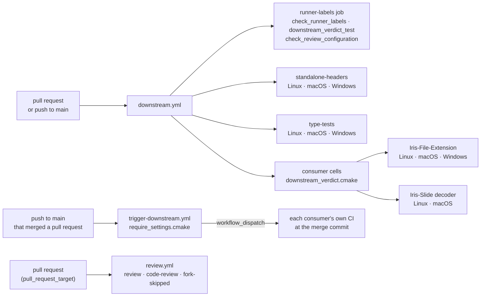

# Pipeline

How Iris-Headers' workflows build, check and review a change, and the settings they need.
Written 2026-11-27 (ContributingPipelineQuestion_10, PlansPrivate_7.4) from the comments of
`.github/workflows/` and `cmake/` and the CI rules this repository adopted on 2026-11-24
(SafetyNet_1). These are the rules specific to this repository, numbered so a commit or a
review can cite one; the family's general CI-runner conventions are kept privately by the
maintainers, and the review bot's findings name the rule they apply.

## Rules

1. **Three workflows.** `downstream.yml` builds and checks every change, on every pull request,
   every push to `main` and by hand; a new commit cancels the running run of the same ref.
   `trigger-downstream.yml` starts each consumer's own CI after a merge (rule 8). `review.yml`
   runs the review bot on every pull request that is not a draft (rules 9 and 10).
2. **Every job runs on a pinned Blacksmith label** (BlacksmithRunners_1.4, decided 2026-11-24):
   Linux on `blacksmith-2vcpu-ubuntu-2404`, Windows on `blacksmith-2vcpu-windows-2025` (Visual
   Studio Build Tools 2022 with the ClangCL toolset), macOS on `blacksmith-6vcpu-macos-15`, from
   [Blacksmith's runner overview](https://docs.blacksmith.sh/blacksmith-runners/overview) (read
   2026-11-24). `cmake/check_runner_labels.cmake` fails on any other label, and
   `.github/actionlint.yaml` declares these three so actionlint knows them.
3. **The consumers prove a change** (DownstreamBuild_1.2). The `consumer` cells build
   Iris-File-Extension (with its tests; Linux, macOS, Windows) and the Iris-Slide decoder (a
   build check; Linux, macOS) against the change, and against the base when that fails.
   `cmake/downstream_verdict.cmake` gives each cell's verdict, stated at its top: a change that
   breaks a consumer fails; a consumer already broken against the base warns; a configure
   failure against the base fails as broken tooling. Each consumer is built from its branch
   named like the pull request's head when one exists (a coordinated change), else from `main`;
   when a paired branch was used and the change is green on it, the consumer's `main` is built
   against the change too, and red there fails the cell naming the consumer's open pull request,
   so the two merge together (ReviewBot_1.5, after every consumer cell failed on `main` on
   2026-11-24). Iris-File-Extension takes this checkout through
   `FETCHCONTENT_SOURCE_DIR_IRISHEADERS`; Iris-Slide takes it as a vcpkg overlay port.
4. **Every header and type is checked on all three systems.** The `standalone-headers` cells
   compile each header alone and all together (`cmake/standalone_headers.cmake`); the
   `type-tests` cells build and run `tests/types_test.cpp` (`IRIS_HEADERS_BUILD_TYPE_TESTS`).
   Linux and macOS use Ninja with `clang++`; Windows uses the default Visual Studio generator
   with `-T ClangCL`.
5. **A `run:` step calls CMake**, and its logic lives in a `cmake -P` script under `cmake/`,
   which runs the same on every operating system's shell and locally. The `runner-labels` job
   runs the three repository checks: `check_runner_labels.cmake`,
   `tests/downstream_verdict_test.cmake` (hermetic: the three outcomes of the paired-branch
   verdict) and `check_review_configuration.cmake` (rule 9). The steps that remain shell today
   are the package installs (Ninja, Meson, NASM, pkg-config) and `trigger-downstream.yml`'s two
   GitHub API steps.
6. **Pin what can move.** Every action is pinned by its full commit SHA with its version in a
   comment (`actions/checkout` v7.0.1, `actions/create-github-app-token` v3.3.0, the cache and
   artifact actions); Catch2 is fetched at 3.15.1 by SHA-256 in `CMakeLists.txt`; the review bot
   at `GOVERNANCE_COMMIT`. `cmake/dependencies.cmake` holds the third-party versions the
   consumers read from this repository, until PinsAndSimdMoved_3.3 moves them to Iris-Slide.
7. **Least privilege, bounded.** Every workflow starts from `permissions: {}` and each job grants
   what it uses (`contents: read` for the builds); every checkout has
   `persist-credentials: false`; text a pull request's author chose (its head branch) reaches a
   script only through `env:`; every job has `timeout-minutes`.
8. **Settings are checked first.** A job that needs a variable or secret names each missing one
   in its first step, `cmake -P cmake/require_settings.cmake`, which receives only `true` or
   `false` for each, before an action fails without saying which setting to create (ReviewBot_1.5,
   after `trigger-downstream` failed on every merge from 2026-11-14). `trigger-downstream.yml`
   runs on a push to `main` and dispatches only when GitHub associates the pushed commit with a
   merged pull request; it needs the variable `DOWNSTREAM_APP_CLIENT_ID` and the secret
   `DOWNSTREAM_APP_PRIVATE_KEY` in the `downstream-dispatch` environment, from a GitHub App with
   Actions write only, installed on Iris-File-Extension and Iris-Slide, which the maintainer
   creates. It starts Iris-File-Extension's `ci.yml` and Iris-Slide's three CMake CI workflows
   with `iris_headers_ref` set to the merge commit.
9. **The review workflow is safe under `pull_request_target`** (ReviewBot_1.5). No step checks
   out, builds or runs the pull request's head: each job checks out the default branch's commit
   (`github.sha`), and the head reaches the bot only as `HEAD_SHA`. The `review` job holds
   `ANTHROPIC_KEY` with `contents: read` and `pull-requests: read`, and alone declares
   `cache-mode: write` for its conversation; the `code-review` job holds `pull-requests: write`
   and no key; both run only for a pull request from a branch of this repository, and
   `fork-skipped` states why a fork's gets no model review. The bot is checked out from
   Aptix-Bio/governance at `GOVERNANCE_COMMIT` with `GOVERNANCE_READ_TOKEN`, which reaches that
   checkout step and, as `planning-token`, the bot's action in both jobs, which fetches the
   privately kept rules and plans read-only (rule 10); no other step receives it. `cmake/check_review_configuration.cmake` fails naming each broken
   property.
10. **The rubric is read from the default branch.** `.github/review/rubric.toml` names the items
    and this repository's own documents (`development/ARCHITECTURE.md`, this file,
    `development/README.md`, `CONTRIBUTING.md`), read from the default branch so that a pull
    request cannot change the rules it is judged by. The family's shared rules and items, and this
    repository's work breakdown, requirement rows and errata, are kept privately; the bot's action
    fetches them read-only with `planning-token` into its own checkout, the bot reads them with
    `--planning`, and the rubric names them by file name only.
    `check_review_configuration.cmake` fails when a file the rubric names here is missing, or a
    privately kept file is named by a path. The rubric, `review.yml`, CODEOWNERS and `cmake/` are
    code-owner files.
