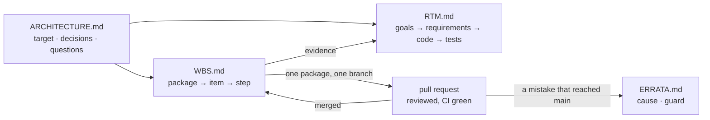

# development/

How Iris-Headers is planned, tracked and verified. The design contract is
[ARCHITECTURE.md](ARCHITECTURE.md): the shared vocabulary of the Iris family, what leaves it and
what stays, and the decisions that follow. This folder breaks that contract down to work
packages, items and requirements. The documentation a consumer reads is the repository's
`README.md` and the headers' own doc comments.

The maintainers keep the family's general conventions for code, planning and CI privately; the
review bot's findings name the rule they apply. This repository's own rules belong in a
CONTRIBUTING.md and a development/PIPELINE.md, which it does not have yet
(ContributingPipelineQuestion_10); until it does, they are [style_guide.md](style_guide.md) and
[ci_runners.md](ci_runners.md) (LocalRulesQuestion_11).

| File | Use it to… |
|---|---|
| [ARCHITECTURE.md](ARCHITECTURE.md) | know what Iris-Headers is for, what it held on 2026-11-12, the target, and every decision and open question (§4) |
| [WBS.md](WBS.md) | track the work package by package: each item and its red-first steps, each tick with its evidence and commit link; the order; the session log |
| [RTM.md](RTM.md) | trace each requirement back to the goals and forward to code and tests, with its status |
| [ERRATA.md](ERRATA.md) | the mistakes that reached `main`, a consumer or a measurement: cause, how found, the guard now in place |
| [style_guide.md](style_guide.md) | the binding conventions for code, plans and prose |
| [ci_runners.md](ci_runners.md) | the rules every workflow follows: when a runner runs, reuse, caches, robustness |

## How a package runs

A work package is a few days of work, three to six items *(estimate, not measured)*, that ends
in something a reviewer can run or read, and one pull request.

1. The branch is `<kind>/<PackageName>_<n>` (`docs/DevelopmentLayout_7`,
   `feature/StrongIndices_4.2`), named before the first push, since renaming a pull request's
   head branch closes the pull request. One pull request is open in this repository at a time;
   further work goes onto its branch while it is open.
2. Each item that changes behaviour starts with a test shown red, its failure quoted; then the
   code that turns it green, with the evidence (test counts, the command run) and the commit.
3. The package's **Shown by** command demonstrates it; its output goes into the pull request.
4. The package closes with **VERIFY** (the maintainer's check) and **Gate** (CI green on the pull
   request). A task that waits on an answer or another repository is marked `blocked` and does
   not hold its package.
5. A change a consumer compiles has a paired branch of the same name in each consumer;
   Iris-Headers merges first, and each pull request names the others and the merge order
   ([ERRATA.md](ERRATA.md), 2026-11-24).

The pull request's description has these sections, in this order: Summary · WBS (the items
ticked, with evidence and commit links) · RTM (rows added or moved, with evidence) · Decisions
(dated, each stated as a plain requirement, recorded in ARCHITECTURE.md §4) · Measurements ·
Test results (per cell, local and CI) · Red first · Failures fixed (symptom, root cause, fix,
commit) · Consumer impact (what Iris-File-Extension and Iris-Slide must change, and the merge
order of a coordinated change) · Security impact · AI authorship (which parts an AI agent wrote,
with which tool and model, and what the maintainer did). `.github/pull_request_template.md` holds
these sections, then the "Agent review" boxes the review bot ticks against
`.github/review/rubric.toml`.

## Identifiers

Every ID says what it is and is spelled out; no abbreviations.

| Kind | Form | Example |
|---|---|---|
| WBS package | `PascalCaseName_<n>` | `SafetyNet_1`, `ArenaClaim_8` |
| WBS item | `PascalCaseName_<n>.<m>` (and `.<k>` below it) | `StrongIndices_4.2`, `TileEncodingBlocks_5.4.2` |
| Decision or question | `PascalCaseNameQuestion_<n>`, numbered across ARCHITECTURE.md §4 | `ResultShapeQuestion_3` |
| RTM row | `PascalCaseArea_<nn>` | `Runtime_04` |
| Goal | `Goal_<nn>` | `Goal_09` |

Code carries `// RTM <ID>` (C++) or `# RTM <ID>` (CMake, workflows); a Catch2 test carries
`[<ID>]`. Code written before the RTM existed names its WBS ID in a comment instead.

**Identifiers are stable.** An ID is never renumbered or reused, because commits, pull requests,
code comments and other repositories refer to it. New work takes the next free number in its
package or area. Dropped work stays in the WBS, struck through, with its reason; a retired RTM
row keeps its ID with the status `Retired`.

## Update rule

A commit that changes code updates the WBS steps it completes and the RTM rows it touches, in the
same commit. Each ticked step, and each RTM row moved to Implemented or Verified, links the commit
that did the work, `[1234567](https://github.com/Aptix-Bio/Iris-Headers/commit/<full hash>)`, on
the same line; since a commit cannot name its own hash, a follow-up trace commit adds the links.
The review bot checks every such line without the model (`[trace]` in the rubric). A decision is
recorded, dated, in its ARCHITECTURE.md §4 row. Commits are staged by explicit path.
