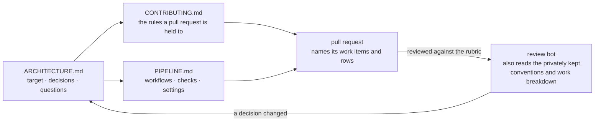

# development/

How Iris-Headers is designed and built. The design contract is
[ARCHITECTURE.md](ARCHITECTURE.md): the shared vocabulary of the Iris family, what leaves it and
what stays, and the decisions that follow. The pipeline's rules are [PIPELINE.md](PIPELINE.md),
and the rules a pull request is held to are the repository's
[CONTRIBUTING.md](../CONTRIBUTING.md). The documentation a consumer reads is the repository's
`README.md` and the headers' own doc comments.

The maintainers keep the family's general conventions for code, planning and CI privately, and
with them this repository's work breakdown, requirement rows and errata (decided 2026-11-27,
LocalRulesQuestion_11); the review bot reads them from its own checkout, and its findings name
the rule they apply. The IDs below name their entries in ARCHITECTURE.md, in the code and in
pull requests.

| File | Use it to… |
|---|---|
| [ARCHITECTURE.md](ARCHITECTURE.md) | know what Iris-Headers is for, what it held on 2026-11-12, the target, and every decision and open question (§4) |
| [PIPELINE.md](PIPELINE.md) | the numbered rules of the workflows: the consumer cells, the CMake checks, pins, settings and the review workflow |
| [../CONTRIBUTING.md](../CONTRIBUTING.md) | the numbered rules a pull request is held to: headers, consumers, the vocabulary, tests, identifiers |
| README.md (this file) | the files of this folder and the ID scheme |

## Identifiers

Every ID says what it is and is spelled out; no abbreviations.

| Kind | Form | Example |
|---|---|---|
| WBS package | `PascalCaseName_<n>` | `SafetyNet_1`, `ArenaClaim_8` |
| WBS item | `PascalCaseName_<n>.<m>` (and `.<k>` below it) | `StrongIndices_4.2`, `TileEncodingBlocks_5.4.2` |
| Decision or question | `PascalCaseNameQuestion_<n>`, numbered across ARCHITECTURE.md §4 | `ResultShapeQuestion_3` |
| RTM row | `PascalCaseArea_<nn>` | `Runtime_04` |
| Goal | `Goal_<nn>` | `Goal_09` |

Code carries `// RTM <ID>` (C++) or `# RTM <ID>` (CMake, workflows); a Catch2 test carries
`[<ID>]`. Code written before the RTM existed names its WBS ID in a comment instead.

**Identifiers are stable.** An ID is never renumbered or reused, because commits, pull requests,
code comments and other repositories refer to it. New work takes the next free number in its
package or area. Dropped work keeps its ID, struck through, with its reason; a retired
requirement row keeps its ID with the status `Retired`.

## Tracing a change

A pull request's description names the work items it completes or advances and the requirement
rows it touches, by their IDs; the ticks and statuses, each linking the commit that did the work,
`[1234567](https://github.com/Aptix-Bio/Iris-Headers/commit/<full hash>)`, are kept privately with
the work breakdown, and the review bot checks every link without the model (`[trace]` in the
rubric). A decision is recorded, dated, in its ARCHITECTURE.md §4 row. Commits are staged by
explicit path.
