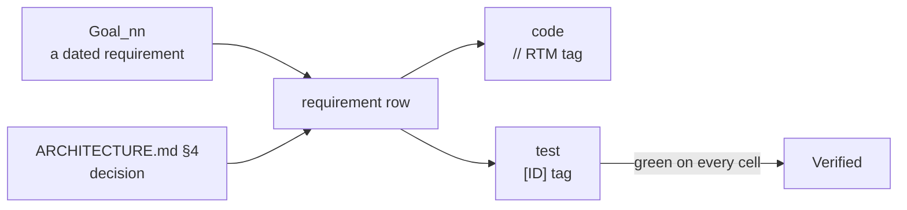

# Requirements Traceability Matrix

Every requirement traces back to the goal it serves and forward to the code that satisfies it and
the tests that prove it. Started 2026-11-26 (DevelopmentLayout_7); before then the plan's
decisions stood in for a matrix.

- **Source:** `Goal_nn` (below) · a `…Question_n` decision of [ARCHITECTURE.md](ARCHITECTURE.md)
  §4 · an [ERRATA.md](ERRATA.md) row, by its date.
- **Package:** the [WBS](WBS.md) package or item that delivers the row.
- **Status**, defined by evidence: `Planned` (written; no code yet) · `Implemented` (the code
  exists and is tagged with the row's ID) · `Verified` (its tests green on every CI cell that
  runs them) · `Partial` (part met; the note says which) · `Blocked` (waiting on a named question
  or dependency) · `Retired` (no longer required; the ID stays and is never reused). A status
  says where it holds when that is narrower than every cell.
- **Tests:** `Unit` · `Contract` (a public call's promise) · `Integration` (a consumer built and
  tested against the change) · `Concurrency` (under ThreadSanitizer) · `Static` (a check that
  reads the source, the workflows or the settings) · `Benchmark` · `Review` (a document the
  maintainer reads; no test can prove it).
- **Tags:** a comment line `// RTM <ID>[, <ID>…]` (C++) or `# RTM <ID>[, <ID>…]` (CMake,
  workflows) on the code and the test; Catch2 tests also carry the tag `[<ID>]`. The code of the
  work done before 2026-11-26 names its WBS IDs and carries no RTM tag yet, so its rows are
  `Partial` until RtmTagsBackfilled_7.3 tags them; the Catch2 tags in `tests/` today (`[Result]`,
  `[Queue]`, `[Memory]` and the rest) are area tags, and none of them names a row.

## Goals

| Goal | Requirement, with the date it was decided |
|---|---|
| Goal_01 | 2026-11-12: Iris-Headers is the common language of the open-source and proprietary projects that depend on it, and any change it needs is allowed, so that it reaches the most modern design it can take |
| Goal_02 | 2026-11-12: only the shared vocabulary stays in Iris-Headers; the viewer's API moves to the viewer, and the codec's API, GPU context, SIMD kernels and dependency pins move to Iris-Slide (VocabularyScopeQuestion_1) |
| Goal_03 | 2026-11-12: `Aptix-Bio/Iris-Headers` is the canonical repository, public under MIT, released by signed SemVer tags that consumers pin with their hash (CanonicalHomeQuestion_2) |
| Goal_04 | 2026-11-12: `Result` carries a scoped severity, the project's domain, that project's own code, a message with the offending value and the place of failure; it is checked by `succeeded()` or `failed()` with no conversion to `bool`, `[[nodiscard]]` and `noexcept` throughout (ResultShapeQuestion_3) |
| Goal_05 | 2026-11-12: one breaking release, 2.0.0, with every consumer moved in step and proven by the downstream build before the tag; no deprecation shim (BreakingReleaseQuestion_4) |
| Goal_06 | 2026-11-12: indices of different things are different types, one `StrongIndex<Tag>` template, emitted by IFE's generator (StrongIndicesQuestion_5) |
| Goal_07 | 2026-11-12: `MemoryArena`, `Buffer`, `Queue` and `Async` stay here as the `iris_headers_runtime` library, which IFE and Iris-Slide link (MemoryArenaQuestion_6) |
| Goal_08 | 2026-11-12: a change here is proven in each dependent repository's own CI, and an unmerged change never reaches a consumer |
| Goal_09 | 2026-11-12: nothing on the path of a push, a pop or an issued task waits for another thread; a consumer claims an entry by compare-and-swap and moves on when it loses; the queue holds move-only entries; designs are measured at realistic task lengths as well as with trivial tasks |
| Goal_10 | 2026-11-12: every enumeration is scoped in the type it describes, its values named from IFE's constants, with no aliases for the old names |
| Goal_11 | 2026-11-12: the viewer's creation returns a `Result` and writes the viewer through an output parameter; the engine thread runs paced by the display; the WebAssembly viewer binds to a page's canvas by CSS selector |
| Goal_12 | 2026-11-24: the open-source decoder and encoder of slide files is named Iris-Slide, in every repository |
| Goal_13 | 2026-11-24: every CI job runs on a pinned Blacksmith runner |
| Goal_14 | 2026-11-24: every pull request is reviewed by the Aptix governance review bot against this repository's own rubric, and the CI failures found on `main` that day are guarded |
| Goal_15 | 2026-11-25: tile encoding 3 is AV1, a bare sequence in the AV1 Low Overhead Bitstream Format, and the cache's value 3 follows it; associated images keep AVIF (TileEncodingAv1Question_7) |
| Goal_16 | 2026-11-25: tile encodings 4 and 5 are the bare GPU block-compressed UASTC and XUASTC streams; the cache does not mirror them (TileEncodingBlocksQuestion_8) |
| Goal_17 | 2026-11-25: the encoder takes a slide's attributes from its caller, as the existing `Attributes` type, and Iris-Headers names no I2S key |
| Goal_18 | 2026-11-26: Iris-Headers' planning documents take the family's `development/` layout (ARCHITECTURE, WBS, RTM, README, ERRATA), replacing the single plan file |
| Goal_19 | 2026-11-26: the arena's write head and its single-instruction claim of a slice return beside `Iris::Memory`, complete enough that no Iris repository reads FastFHIR for it, and a claim never waits (ArenaClaimQuestion_9) |
| Goal_20 | 2026-11-12: IFE 1.1's parked format facts (focal planes, microns per plane, the clinical metadata range, the new tile encodings) land in the shared types |

## Requirements

| ID | Requirement | Source | Package | Tests | Status |
|---|---|---|---|---|---|
| SafetyNet_01 | Every public header compiles alone and all together in one translation unit, on Linux, macOS and Windows, with Clang | Goal_08 | StandaloneHeaderBuild_1.1 | Static | Partial: `cmake/standalone_headers.cmake` exists under its WBS ID and is green with Apple clang 21; the Linux, macOS and Windows cells owe a green run; RTM tags by RtmTagsBackfilled_7.3 |
| SafetyNet_02 | IFE and Iris-Slide are built and tested against the change, with a control run against the base so a consumer already red does not block; a merged pull request starts each consumer's own CI against the merge commit, and an unmerged change reaches no consumer | Goal_08 | DownstreamBuild_1.2 | Integration, Static | Partial: `downstream.yml`, `trigger-downstream.yml` and `cmake/downstream_verdict.cmake` exist under their WBS IDs; the GitHub App, the consumers' `iris_headers_ref` inputs and a green run are owed; RTM tags by RtmTagsBackfilled_7.3 |
| SafetyNet_03 | The shared types' behaviour that consumers rely on is held by type tests that run on Linux, macOS and Windows | Goal_08 | TypeTests_1.3 | Unit | Partial: `tests/types_test.cpp` exists under its WBS ID (29 test cases) and `downstream.yml`'s type-test job runs it; RTM tags by RtmTagsBackfilled_7.3 |
| SafetyNet_04 | Every job runs on a pinned Blacksmith label, and a check fails on any other label | Goal_13 | BlacksmithRunners_1.4 | Static | Partial: `cmake/check_runner_labels.cmake` exists under its WBS ID and the `runner-labels` job runs it; a green run of the current layout is owed; RTM tags by RtmTagsBackfilled_7.3 |
| SafetyNet_05 | Every pull request from a branch of this repository is reviewed by the review bot against `.github/review/rubric.toml`, read from the default branch; the review workflow keeps the safety properties that make `pull_request_target` safe in a public repository, and a check holds them | Goal_14 | ReviewBot_1.5 | Static | Partial: `review.yml`, the rubric and `cmake/check_review_configuration.cmake` exist under their WBS ID; `ANTHROPIC_KEY`, `GOVERNANCE_READ_TOKEN` and a green review run are owed; RTM tags by RtmTagsBackfilled_7.3 |
| SafetyNet_06 | A change green only on a consumer's paired branch fails, naming the consumer's open pull request and the merge order | Goal_08, ERRATA 2026-11-24 | ReviewBot_1.5 | Static | Partial: `cmake/downstream_verdict.cmake` and its test `cmake/tests/downstream_verdict_test.cmake` exist under their WBS ID; RTM tags by RtmTagsBackfilled_7.3 |
| SafetyNet_07 | A job that needs a repository variable or secret names each missing one in its first step, before an action fails | ERRATA 2026-11-14 | ReviewBot_1.5 | Static | Partial: `cmake/require_settings.cmake` exists under its WBS ID; the App's settings are still unset; RTM tags by RtmTagsBackfilled_7.3 |
| Release_01 | The development fork's commits are merged into the canonical repository by pull request, so the transfer carries one history | Goal_03 | ForksReconciled_2.1 | Review | Planned |
| Release_02 | The canonical repository is `Aptix-Bio/Iris-Headers`, public, MIT unchanged; consumers name `Aptix-Bio` as the owner; nothing is created at the old location | Goal_03 | TransferredToAptix_2.3 | Review | Planned |
| Release_03 | `v1.0.0` is a signed tag on `Aptix-Bio/Iris-Headers` matching `MODULE.bazel`'s version, and each consumer pins it | Goal_03 | FirstTag_2.2 | Static | Planned |
| Release_04 | `v2.0.0` is tagged once the downstream build is green for every consumer against it; each consumer's pin moves in its own pull request | Goal_05 | BreakingRelease_6.1 | Integration | Planned |
| Scope_01 | `IrisCore.hpp`'s viewer functions, info structs and `Viewer` / `Slide` handles are deleted; the Buffer functions move to the runtime library | Goal_02 | ViewerApiRemoved_3.1 | Static | Planned |
| Scope_02 | The codec's handles and API, the `Iris::Instance` / `Device` / `Queue` aliases and `priv/IrisCoreVulkan.hpp` move to Iris-Slide; a translation unit that defines `Iris::Device` as a class includes the codec's headers | Goal_02 | CodecApiMoved_3.2 | Static | Planned |
| Scope_03 | `cmake/dependencies.cmake`, `IrisSIMD` and its tests move to Iris-Slide, with IFE's and the codec's builds updated in the same step | Goal_02 | PinsAndSimdMoved_3.3 | Static, Integration | Planned |
| Scope_04 | `priv/IrisCorePython.hpp` moves to the binding that uses it, or is deleted if none does | Goal_02 | PythonGlueMoved_3.4 | Static | Planned |
| Vocabulary_01 | `Result` has the shape of Goal_04; Iris-Headers' own failures carry `Domain::IRIS_HEADERS` and a `HeadersError` code with the offending value; every consumer moved | Goal_04 | ResultRedesigned_4.1 | Unit, Integration | Partial: the new `Result` exists in `include/IrisTypes.hpp` under its WBS ID and its type tests pass; IFE and Iris-Slide moved; the Windows standalone-header cell is owed; RTM tags by RtmTagsBackfilled_7.3 |
| Vocabulary_02 | `LayerIndex`, `TileIndex`, `PlaneIndex` and `ImageIndex` are instances of one `StrongIndex<Tag>`, so one cannot be passed where another is expected | Goal_06 | StrongIndices_4.2 | Unit | Planned |
| Vocabulary_03 | Every enumeration is scoped in the type it describes (`Iris::File::Encoding`, `Iris::Image::Format`, `Iris::Image::Encoding`), with values named from IFE's constants and no aliases for the old names | Goal_10 | ScopedEnumerations_4.3 | Unit, Static | Planned |
| Vocabulary_04 | `IRIS_EXPORT` has three states (export, import, static), and no enumeration carries it | Goal_01 | ExportMacro_4.4 | Static | Planned |
| Vocabulary_05 | Headers live under `include/Iris/` with `#pragma once`, no reserved identifiers, and clang-tidy clean with the family's checks | Goal_01 | LayoutAndGuards_4.6 | Static | Planned |
| Runtime_01 | `iris_headers_runtime` is a static library of Buffer, Queue, Async and MemoryArena in CMake and Bazel; its functions are `snake_case`, and each declared function is defined | Goal_07 | RuntimeLibraries_4.5 | Static | Planned |
| Runtime_02 | `MemoryArena` opens wide paths on Windows (`CreateFileW`) | Goal_07 | WindowsPaths_4.7 | Unit | Planned |
| Runtime_03 | `Buffer_t::append(data, size)` grows the buffer and writes the bytes when they do not fit | Goal_07 | BufferAppendGrows_4.9 | Unit | Planned: a `[!shouldfail]` type test records the defect |
| Runtime_04 | `Iris::FIFO::Queue` is the one Iris queue: several producers and consumers, an entry claimed by one compare-and-swap, moved in and out, nothing lost, nothing on a push or a pop waiting, and no segment freed while a cursor can reach it | Goal_09 | AsyncRebuilt_4.12 (with IteratorFromOldestNode_4.8, QueueMovesEntries_4.10, QueueManyProducers_4.11) | Unit, Concurrency | Partial: `priv/IrisQueue.hpp` exists under its WBS IDs, tested under ThreadSanitizer and AddressSanitizer on macOS arm64; Linux and Windows are *(to measure)*; RTM tags by RtmTagsBackfilled_7.3 |
| Runtime_05 | `Iris::Async::Pool` distributes work through that queue with no mutex and no condition variable; a task is stored inline; a fence always settles; one issuer is no slower than the previous pool | Goal_09 | AsyncRebuilt_4.12, PoolCountersSplit_4.13 | Unit, Concurrency, Benchmark | Partial: `priv/IrisAsync.hpp` and `src/IrisAsync.cpp` exist under their WBS IDs, tested and measured on macOS arm64; memory after a burst and Linux and Windows are *(to measure)*; RTM tags by RtmTagsBackfilled_7.3 |
| Format_01 | `LayerExtent::zPlanes` (`uint16_t`, never zero in memory), and IFE's parallel `planes` vector deleted | Goal_20 | ZPlanes_5.1 | Unit | Planned |
| Format_02 | `Metadata::micronsPerPlane` | Goal_20 | MicronsPerPlane_5.2 | Unit | Planned |
| Format_03 | Clinical metadata as offset, size and encoding | Goal_20 | ClinicalRange_5.3 | Unit | Planned |
| Format_04 | `TILE_ENCODING_AV1 = 3` and `CACHE_ENCODING_AV1 = 3`, matching IFE's `tile_encodings` value for value; `IMAGE_ENCODING_AVIF` stays | Goal_15 | TileEncodingAv1_5.4.1 | Unit, Integration | Partial: `include/IrisSlideTypes.hpp` and its type test exist under the WBS ID; a green `downstream` run with the consumers' paired branches is owed; RTM tags by RtmTagsBackfilled_7.3 |
| Format_05 | `TILE_ENCODING_UASTC = 4` and `TILE_ENCODING_XUASTC = 5`, with no cache members, the cache keeping LZ and no compression at 4 and 5 | Goal_16 | TileEncodingBlocks_5.4.2 | Unit, Integration | Partial: `include/IrisSlideTypes.hpp` and its type test exist under the WBS ID; a green `downstream` run with the consumers' paired branches is owed; RTM tags by RtmTagsBackfilled_7.3 |
| Format_06 | `EncodeSlideInfo::attributes` is the existing `Attributes`, empty, `METADATA_UNDEFINED` and version 0 by default | Goal_17 | EncodeSlideInfoAttributes_5.5 | Unit, Integration | Partial: the member and its type test exist under the WBS ID; a green `downstream` run with Iris-Slide's branch is owed; RTM tags by RtmTagsBackfilled_7.3 |
| Viewer_01 | `create_viewer(const ViewerCreateInfo&, Viewer&)` returns a `Result` and writes the viewer to its output; `viewer_display_refreshed(const Viewer&)` only wakes the engine thread and never waits | Goal_11 | ViewerLifecycleResult_4.14 | Contract | Partial: the declarations exist in `include/IrisCore.hpp` under the WBS ID; their tests are the viewer's own, none in this repository; the row retires with ViewerApiRemoved_3.1 |
| Viewer_02 | Under `__EMSCRIPTEN__`, `ViewerBindExternalSurfaceInfo` carries the CSS selector of the page's canvas | Goal_11 | ViewerCanvasSelector_4.15 | Contract | Partial: the member exists under the WBS ID; its test is the viewer's own; the row retires with ViewerApiRemoved_3.1 |
| Process_01 | `development/` holds ARCHITECTURE.md, WBS.md, RTM.md, README.md and ERRATA.md in the family's layout, and every reference names the file and section that holds the content | Goal_18 | DocumentsSplit_7.1, ReferencesMoved_7.2 | Review, Static | Partial: the split and the moved references are done; the maintainer's review is owed |
| Process_02 | Every requirement row at Implemented or Verified has its tag on the code and on a test, and every test tag names a row | Goal_18 | RtmTagsBackfilled_7.3 | Static | Planned |
| Arena_01 | `claim(bytes)` returns a slice of the arena by load, bounds check, compare-and-swap and commit; a thread that loses retries with the new head; two threads never receive overlapping slices | Goal_19 | WriteHeadClaim_8.1, ClaimTests_8.4 | Concurrency | Planned |
| Arena_02 | A claim past capacity fails naming the head, the capacity and the bytes asked, and the head never passes capacity | Goal_19 | WriteHeadClaim_8.1, ClaimTests_8.4 | Unit | Planned |
| Arena_03 | The stream head serves a stream of unknown length; a claim made while a stream holds the head fails at once with a named result, since nothing on a hot path waits | Goal_19 | StreamHeadPorted_8.2, ClaimTests_8.4 | Concurrency | Planned |
| Arena_04 | The claim's public surface returns a `Result` and writes the slice through an output reference, `noexcept`, its doc comments at the top of the header | Goal_19 | ClaimSurface_8.3 | Contract | Planned |
| Arena_05 | IFE's Builder can claim its tiles' bytes through the arena's claim in place of its own bump | Goal_19 | BuilderClaimsThrough_8.5 | Integration | Planned |
