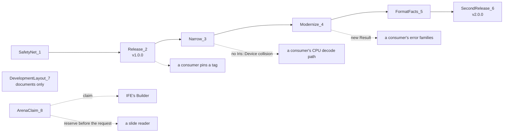

# Work Breakdown Structure

The tracking sheet for Iris-Headers' work, written top down: each **work package** states its
purpose; each **item** under it states what it achieves, with its evidence; the **steps** nested
under an item are the checkable implementation, red first. The design it carries out, the
decisions and the open questions are in [ARCHITECTURE.md](ARCHITECTURE.md); the requirements and
their status in [RTM.md](RTM.md); the mistakes and their guards in [ERRATA.md](ERRATA.md).
[README.md](README.md) gives the ID scheme, how a package runs and the pull request's sections.
Moved here on 2026-11-26 from the repository's single plan file (DevelopmentLayout_7), every ID,
tick, evidence line and commit link as it was written there.

## Conventions

Names follow the family's convention (phase → work package → task → steps;
spelled-out names; evidence on every tick). Each phase leaves every consumer
building.

- **Red first.** A task that changes behaviour starts with a test shown failing, its failure
  quoted; it is ticked only with the green evidence. A measurement or document task has no red
  step and is ticked with the numbers or the review. A test that records existing behaviour was
  never red, and its tick says so.
- **One tick, one piece of evidence** on the same line (test counts and the command, a
  measurement, a reviewed document, a CI run) and a link to the commit that did the work,
  `[1234567](https://github.com/Aptix-Bio/Iris-Headers/commit/<full hash>)`. A commit cannot name
  its own hash, so a follow-up trace commit adds the link. The review bot checks every new tick
  (`.github/review/rubric.toml`, `[trace]`). Ticks moved here from the earlier plan file keep the
  evidence they were written with; some predate the link rule and carry none.
- **VERIFY** is the maintainer's check; **Gate** is CI green on the pull request. Both close a
  package.
- **Status** after a package's name: `todo`, `ready` (its dependencies are merged), `doing`,
  `blocked` (with the reason), `done`. A blocked task does not hold its package: it is marked
  `blocked` with the question or dependency it waits on.
- **A coordinated change** has a paired branch of the same name in each consumer; Iris-Headers
  merges first, and each pull request names the others and the merge order
  ([ERRATA.md](ERRATA.md), 2026-11-24).
- **Identifiers are stable.** An ID is never renumbered or reused; new work takes the next free
  number in its package. Dropped work stays, struck through, with its reason.

## SafetyNet_1 — nothing changes without a consumer proving it `doing`

- [ ] **VERIFY:** **StandaloneHeaderBuild_1.1** — every public header compiles alone and all together in one translation unit, on Linux, macOS and Windows, with Clang (the family's compiler for every cell). Evidence: `cmake/standalone_headers.cmake` (on when top-level); red first: `IrisAsync`, `IrisBuffer`, `IrisQueue`, `IrisSIMD` failed alone (they relied on earlier includes); each now includes what it uses; green with Apple clang 21 (2026-11-12, `5f0d36f`). `IrisCorePython.hpp` (includes IrisV2's missing `IrisCorePriv.hpp`) and `IrisCoreVulkan.hpp` (needs Vulkan and VMA) excluded until Narrow_3 removes them. owes a green run of `downstream.yml`'s Linux, macOS and Windows cells (the Windows cell added after review)
- [ ] **DownstreamBuild_1.2** — IFE and Iris-Slide built and tested against this checkout through `FETCHCONTENT_SOURCE_DIR_IRISHEADERS`, with the control run against the base so a consumer already red does not block; and, when a pull request merges, each consumer's own CI started against the merge commit, only for pull requests closed by merging (decided 2026-11-12: a change here is proven in each dependent repository's own CI, and an unmerged change never reaches a consumer)
  - [x] Proven locally first. Evidence (2026-11-12, Apple clang 21): IFE (the development fork's `d90f458`) against this checkout 24/24 tests (CI builds the organization's tip instead); the Iris-Slide decoder builds and links (it has no tests in that configuration). Both first failed for a reason outside Iris-Headers: Anaconda first on the Mac's PATH, whose old `nm` rejects `-C` (IFE `ife_exported_symbols`) and whose `libturbojpeg.0.4.0` was linked against libjpeg-turbo 3.2.1 headers (Codec, `_tj3InitVersion`); the control build of Codec against unchanged headers failed identically (red/red). IFE's test finds `nm` with `find_program` at test time, so that test depends on PATH order *(worth fixing in IFE)*
  - [x] `.github/workflows/downstream.yml`: on pull requests and pushes to `main`, IFE (tested; Linux, macOS, Windows through ClangCL) and the Codec decoder (Linux, macOS), against the change and then the base; no secret. `.github/workflows/trigger-downstream.yml`: on a push to `main` that GitHub associates with a merged pull request, `workflow_dispatch` of IFE `ci.yml` and Codec's three CMake CI workflows with `iris_headers_ref` set to the merge commit, through a GitHub App token limited to Actions write (which starts runs and cannot push code; `repository_dispatch` would need Contents write, and reading a commit's pull requests needs Pull requests read: [Permissions required for GitHub Apps](https://docs.github.com/en/rest/authentication/permissions-required-for-github-apps), read 2026-11-12); running on `push` instead of `pull_request_target` keeps every input trusted. Actions pinned by SHA (`actions/checkout` v7.0.1, `actions/create-github-app-token` v3.3.0, latest releases on 2026-11-12). Evidence: actionlint clean; zizmor 1.32.0 no findings (`726726a`). **Revised after review (2026-11-12):** the first run showed two cells passing while building nothing (IFE on Windows could not find the Visual Studio 2022 generator; the Codec on Linux lacked Meson), because red against both passed. A configure failure now fails the cell as broken tooling, and red against both warns only after a successful configure; Windows uses the default Visual Studio generator with ClangCL; Meson is installed; the Codec fetches IFE from `IrisDigitalPathology` (`IRIS_DEPS_OWNER`); every job has `contents: read`; the standalone-header check gains a Windows cell, and a type-test job runs TypeTests_1.3 on all three systems. Owes a green run
  - [ ] A GitHub App with Actions write only, installed on IFE and Iris-Slide (and on a third consumer once there is one); its client ID as `DOWNSTREAM_APP_CLIENT_ID` (the pinned action deprecates the app ID) and key as `DOWNSTREAM_APP_PRIVATE_KEY` in a `downstream-dispatch` environment deployable from `main` only. The maintainer creates it
  - [ ] IFE `ci.yml` and Codec's `cmake-*-CI.yml` accept `workflow_dispatch` with an `iris_headers_ref` input and build against that commit; changed in those repositories
  - [ ] A proprietary consumer added as the third once its scaffold merges; after TransferredToAptix_2.3 the workflows name the new owner
  - [ ] Both workflows green on GitHub, and a merge seen to start each consumer's run
- [x] **TypeTests_1.3** — Catch2 tests for today's `Result`, `Buffer`, `IrisQueue`, `Async` and `MemoryArena` behaviour, so the rewrite in Modernize_4 is checked against what consumers rely on. Evidence: `tests/types_test.cpp` (`IRIS_HEADERS_BUILD_TYPE_TESTS`, Catch2 3.15.1 at a pinned hash): 10 tests, 100% under ctest; the queue tests 8 of 8 runs stable (2026-11-12). Run in CI by `downstream.yml`'s type-test job (added after review). These record existing behaviour, so no red-before-green step applies; each new expectation in Modernize_4 is written red first. Found while writing them:
  - `IrisCore.hpp` declares `Buffer_change_strength`, which nothing defines, and `Buffer_write_into_buffer(const Buffer&, size_t)`, while `src/IrisBuffer.cpp` defines a `(Buffer&, size_t&)` overload; neither declared function can be called. No consumer calls them. Fixed in RuntimeLibraries_4.5
  - `FIFO2::Queue::begin()` returns an iterator at the newest node, so an iterator taken after a backlog longer than one node (2048 entries) misses the earlier nodes: 4096 pushed, 2048 popped (2048–4095). `IrisAsync` is safe only because its workers take `begin()` before any task is pushed. Recorded as a `[!shouldfail]` test; fixed in IteratorFromOldestNode_4.8
  - `Async`'s thread pool, found by the Windows type-test cell (0 of 100 tasks run) and reproduced on macOS by a 300-round test, red first: a worker that had not reached its loop when `wait_until_complete` began draining never ran anything; the drain's wake-up could be missed, costing up to a second per worker; and `issue_task` counted a task after publishing it, so a worker's earlier decrement was clamped away and `pending_tasks()` stayed 1. Fixed in `src/IrisAsync.cpp`: workers run what is queued before checking the status, the status changes under the workers' mutex with a predicate wait, and a task is counted before it is published; 100 of 100 local runs pass. A missed notification of a newly issued task still waits up to a second, unchanged and left to Modernize_4
- [ ] **VERIFY:** **BlacksmithRunners_1.4** — every job of `downstream.yml` and `trigger-downstream.yml` runs on a Blacksmith runner (decided 2026-11-24, because GitHub-hosted jobs in Aptix-Bio's private repositories stopped starting over billing that day). A label-only change: labels from [Blacksmith's runner overview](https://docs.blacksmith.sh/blacksmith-runners/overview) (read 2026-11-24), each the OS version the GitHub-hosted cell ran: `ubuntu-24.04` → `blacksmith-2vcpu-ubuntu-2404` (2 vCPU, 8 GB; the heaviest cell, IFE's tests, ran in 2.5 min on GitHub's 4-vCPU runner, and Ninja's default of nproc + 2 jobs fits 8 GB); `windows-2025` → `blacksmith-2vcpu-windows-2025` (public beta, 7 GB, Visual Studio Build Tools 2022 in place of the full IDE); `macos-15` → `blacksmith-6vcpu-macos-15` (Apple M4; Blacksmith follows GitHub's macos-15 image). A macOS minute bills as twenty 2-vCPU Linux minutes (same page, FAQ); gating the macOS cells on the cheap ones (`needs:`, [ci_runners.md](ci_runners.md), Cheapest first) is left to the per-platform reusable workflow decided 2026-11-24 (unified workflows whose steps are CMake scripts, so one script runs the same locally and in CI), so this change stays a label change. Red first: `cmake/check_runner_labels.cmake` (`cmake -P`, run by the new `runner-labels` job) reported 13 problems on the base `902b769` (every `ubuntu-24.04`, `macos-15` and `windows-2025` label, and `runs-on: ubuntu-24.04` in `trigger-downstream.yml`), exit 1; exit 0 after the move; actionlint 1.7.12 clean with the labels declared in `.github/actionlint.yaml`. First run on Blacksmith (run 45428962213, 2026-11-24, an earlier layout of this branch with the macOS cells split into gated jobs): every cell green on Blacksmith runners, among them ClangCL 19.1.5 on the Windows Build Tools (IFE 24/24 tests) and both macOS consumer cells; the two Linux consumer cells first failed at configure because IFE's paired branch was pushed seconds after they looked for it (IFE `main` still lists `IrisCodecTypes.hpp`), and passed on rerun. Owes a green run of this layout
- [ ] **VERIFY:** **ReviewBot_1.5** — every pull request reviewed against this repository's own rules by the Aptix governance review bot, and the two CI failures found on `main` after the merges of 2026-11-24 guarded (decided 2026-11-24: Iris-Headers is reviewed as the other Aptix repositories are, with a rubric of its own; [ERRATA.md](ERRATA.md) records the failures)
  - [x] The two failures recorded in `development/ERRATA.md`, each checked against its run logs: the consumer cells red on `main` after the rename (runs 45439563519, 45443381719) and `trigger-downstream` red on every merge since 2026-11-14 (runs 43599084614 to 45443381811) — [bf3f816](https://github.com/Aptix-Bio/Iris-Headers/commit/bf3f816f389955bcfdee85cfd9ed4ae8ac1655a3)
  - [x] Paired-branch guard: `cmake/downstream_verdict.cmake` is the one verdict for both consumers (it clones each consumer at its paired branch, else `main`, so the shell steps that did this are gone), and a change green only on a paired branch fails, naming the consumer's open pull request. Evidence: `cmake/tests/downstream_verdict_test.cmake` red first at [398e77b](https://github.com/Aptix-Bio/Iris-Headers/commit/398e77badbe34aa3f9486c45d2e89707439eba47) (3 of 3 cases fail: the script took a consumer checkout and never built `main`), then 3 of 3 pass; reproduced against GitHub with `HEAD_REF=feature/IrisSlideRename`, the change [140b469](https://github.com/Aptix-Bio/Iris-Headers/commit/140b4697c6351e0c60ef3d6fbeedbadc3a1b1cc7) and the base [8205cba](https://github.com/Aptix-Bio/Iris-Headers/commit/8205cbacddcf806e5582afbd16f8b030b5b5ca8a): IFE's paired branch green, its `main` red at configure, and the cell fails with "a coordinated change: merging this breaks Iris-File-Extension main until Iris-File-Extension#1 merges; merge them together" (Apple clang 21, 2026-11-24). Run by `downstream.yml`'s `runner-labels` job. A configure failure against the change is now attributed to the change when the base configures, since a removed header fails at configure; a configure failure against the base still fails the cell as broken tooling — [bf3f816](https://github.com/Aptix-Bio/Iris-Headers/commit/bf3f816f389955bcfdee85cfd9ed4ae8ac1655a3)
  - [x] Settings guard: `trigger-downstream`'s first step, `cmake -P cmake/require_settings.cmake`, fails naming `DOWNSTREAM_APP_CLIENT_ID` and `DOWNSTREAM_APP_PRIVATE_KEY` while either is unset; the step receives only `true` or `false` for each. Evidence: with both `false` it exits 1 naming both; with both `true`, 0 — [bf3f816](https://github.com/Aptix-Bio/Iris-Headers/commit/bf3f816f389955bcfdee85cfd9ed4ae8ac1655a3)
  - [x] The review bot: `.github/workflows/review.yml` (on `pull_request_target`; the default branch's commit checked out, the head read through the API as data; `permissions: {}` and least privilege per job, the model key only in the job that cannot write; Aptix-Bio/governance checked out at `eea566a` with `GOVERNANCE_READ_TOKEN`, a Contents: read token given to that checkout alone, since a public repository cannot use a private repository's action; forks skipped with a stated reason), `.github/review/rubric.toml` (12 items, 11 blocking, among them AbiAndConsumers, HeaderHygiene and PublicRepository), `.github/CODEOWNERS`, `.github/pull_request_template.md`, `development/style_guide.md` and `development/ci_runners.md` adapted for this repository, and a README section. Evidence: `cmake/check_review_configuration.cmake` red first at [398e77b](https://github.com/Aptix-Bio/Iris-Headers/commit/398e77badbe34aa3f9486c45d2e89707439eba47) (the workflow, rubric, CODEOWNERS and template missing), then green; each of 10 unsafe edits to the workflow (a head checkout, a fetch of the pull request's ref, the token or the model key in another step, the fork condition dropped, an expression in `run:`, a tag pin, a write grant to the review job, a second trigger, a short pin) fails it; the pinned bot's own `load_rubric` and `code_owners` read both files; actionlint 1.7.12 clean; the README diagram renders with mermaid-cli. Run by `downstream.yml`'s `runner-labels` job — [5c15a2f](https://github.com/Aptix-Bio/Iris-Headers/commit/5c15a2fc83c939a40a6c06a24eb5f6d8d0fcf5d9)
  - [ ] The maintainer sets `ANTHROPIC_KEY` and `GOVERNANCE_READ_TOKEN`; a review run green on a pull request here
  - [ ] The GitHub App for `trigger-downstream` created (DownstreamBuild_1.2's open step) and its client ID and key set in the `downstream-dispatch` environment; the next merge dispatches. The maintainer creates it

## Release_2 — a version consumers can pin `todo`

- [ ] **ForksReconciled_2.1** — the fork's 7 commits (`2f6e777` … `0ba637d`) merged into `IrisDigitalPathology/Iris-Headers` by pull request, so the transfer carries one history
- [ ] **TransferredToAptix_2.3** — the maintainer transfers `IrisDigitalPathology/Iris-Headers` to `Aptix-Bio`, public, MIT unchanged (CanonicalHomeQuestion_2); the old URL redirects; IFE's fork-mirroring and Iris-Slide's `cmake/iris-repositories.cmake` name `Aptix-Bio` as the canonical owner; nothing is created at the old location
- [ ] **FirstTag_2.2** — `v1.0.0`, signed, on `Aptix-Bio/Iris-Headers` after TransferredToAptix_2.3, matching `MODULE.bazel`'s version; each consumer's pin of `0ba637d` moved to it

## Narrow_3 — only the vocabulary stays (VocabularyScopeQuestion_1) `todo`

- [ ] **ViewerApiRemoved_3.1** — `IrisCore.hpp`'s viewer functions, info structs and `Viewer` / `Slide` handles deleted; the viewer defines its own lifecycle API in its own repository; the Buffer functions move to the runtime library (Modernize_4)
- [ ] **CodecApiMoved_3.2** — codec handles, `IrisCodecCore.hpp`, the `Iris::Instance` / `Device` / `Queue` aliases, `priv/IrisCoreVulkan.hpp` moved to Iris-Slide under `IrisCodec::`; a consumer test includes a header that defines `Iris::Device` as a class and the codec's headers in one translation unit
- [ ] **PinsAndSimdMoved_3.3** — `cmake/dependencies.cmake`, `IrisSIMD` and its tests moved to Iris-Slide; IFE's and the codec's builds updated in the same step
- [ ] **PythonGlueMoved_3.4** — `priv/IrisCorePython.hpp` moved to whichever binding uses it, or deleted if none does

## Modernize_4 — the types the family's style guide asks for (ResultShapeQuestion_3, StrongIndicesQuestion_5) `doing`

- [ ] **ResultRedesigned_4.1** — `Severity`, `Domain`, code, message, `source_location`; tests red first; every consumer moved (BreakingReleaseQuestion_4)
  - [x] The new `Result` in `include/IrisTypes.hpp`: `Severity`, `Domain`, a 32-bit code from a project's own scoped enumeration (the `ResultCode` concept), message, `std::source_location`; `success()`, `warning()`, `failure()` factories; `succeeded()`, `failed()`, `is_warning()` and `code_as<>()`, all `noexcept` and `[[nodiscard]]`; no conversion to `bool`; a default `Result` fails safe. `ResultFlag` is gone. Iris-Headers' own failures carry `Domain::IRIS_HEADERS` and a `HeadersError` code with the offending value. Evidence: `tests/types_test.cpp` red first (`no member named 'severity' in 'Iris::Result'`), then 15 test cases (two recorded defects failing as expected), five runs stable; the standalone-header check builds (2026-11-12, branch `feature/ResultRedesigned_4.1`)
  - [x] IFE moved: 278 errors in 12 files against this branch, mechanical (216 `IRIS_FAILURE`, 33 `IRIS_SUCCESS`, 16 `!result`), most in `IFE_Runtime.cpp`; IFE gains its own scoped error enumeration. Evidence: the 278 were 18 failure sites and one success site in `IFE_Runtime.cpp`, each compiled into 12 targets, plus about 50 checks in the tests, the example, Builder and Parser. `Iris::File::FileError` names the 13 generated `blocks::Check` values one for one, plus four runtime failures; the runtime tests assert the domain and code, red first (`no member named 'FileError'`). CMake: 24 of 24 tests pass against this branch. IFE's Bazel build fails on `main` too, before reaching this change: without apple_support, Bazel's built-in macOS toolchain rejects the Xcode SDK's `SDKSettings.json` as an absolute include. IFE commit `b09618f` on its local branch `feature/ResultRedesigned_4.1` (2026-11-12)
  - [x] Iris-Slide moved after IFE: 37 errors, 16 in `IrisCodecSlide.cpp`, the rest through the IFE it fetches. Evidence: `IrisCodec::CodecError` added to `include/IrisCodecTypes.hpp`, where the codec's public types live until CodecApiMoved_3.2; its type test was red first (`no member named 'CodecError' in namespace 'IrisCodec'`), then 16 of 16 type tests pass and the standalone-header check builds. The codec's C++ sources, its Python and JavaScript bindings and its READMEs were moved; IFE's failures pass through with IFE's own domain and code. The decoder, the Python module and the WebAssembly module (emsdk 6.0.13) build against this branch. From Python, a missing file fails as `IRIS_CODEC`/`FILE_NOT_OPENED` and a non-Iris file as `IRIS_FILE_EXTENSION`/`BAD_CONSTANT`. The encoder compiles, but its link fails on `tj3InitVersion`: Homebrew's `turbojpeg.h` does not match the libjpeg-turbo it links, outside this change. A breaking change for Python (`ResultFlag`, `success()`, `.value` gone) and JavaScript (`ResultFlag`, `.flag` gone) users. Iris-Slide commit `dc03ee7` on its local branch `feature/ResultRedesigned_4.1` (2026-11-12)
  - [x] A proprietary consumer's error families built on it. Evidence: that consumer built against this checkout; CMake and Bazel green (2026-11-12)
  - [ ] Windows: the standalone-header cell compiles the new names beside `<Windows.h>`
- [x] **QueueMovesEntries_4.10** — `FIFO2::Queue` moves entries in (`push(T)`, by value) and out (`pop`), so it holds move-only entries; it required copyable ones (decided 2026-11-12 for a consumer's completion queue: entries are move-only callables such as lambdas, because wrapping each in a `shared_ptr` to make it copyable adds an allocation and a reference count per entry). Evidence: the type test "holds move-only entries, moved in and out" red first (`Entries within Iris lockless queues must be copiable`), then 17 of 17 type tests pass and the standalone-header check builds (2026-11-12). **Superseded** the same day by QueueManyProducers_4.11, which removes `FIFO2`
- [ ] **StrongIndices_4.2** — `StrongIndex<Tag>`; IFE's generator emits it
- [ ] **ScopedEnumerations_4.3** — every enumeration scoped; values named from IFE's constants
  - [ ] Each enumeration scoped in the type it describes, so an IDE completes it from that scope (decided 2026-11-12, with the recommendation below). Declared here, so every consumer compiles the same values:
    - `Iris::Encoding` (`TILE_ENCODING_*`) becomes `Iris::File::Encoding`: how a tile is stored, file vocabulary in the namespace IFE already uses (`Iris::File::Parser`, `Iris::File::FileError`).
    - `Iris::Format` (`FORMAT_*`, decoded CPU pixel layouts) becomes `Iris::Image::Format`, and `Iris::ImageEncoding` (`IMAGE_ENCODING_*`, associated images) becomes `Iris::Image::Encoding`. `Image` is a class from the start, holding only these, so it can later become the CPU image type without a rename.
    - A consumer's `Iris::Texture::Format` (GPU texture formats) stays in that consumer until a second module produces or consumes GPU textures, then moves here under the same name.
    - No `Iris::Extension::` (a second name for IFE's `Iris::File::`), and no aliases for the old names.
  - [ ] Done inside the one breaking release (BreakingReleaseQuestion_4), right after ResultRedesigned_4.1 on the same branches: IFE, Iris-Slide and the proprietary consumer moved together, red first in each
- [ ] **ExportMacro_4.4** — three-state `IRIS_EXPORT` (IFE's notes to this repository, item 5); IFE's `IRIS_EXPORT=` workaround deleted
- [ ] **RuntimeLibraries_4.5** — `iris_headers_runtime` static library (Buffer, Queue, Async, MemoryArena) in CMake and Bazel; `snake_case` Buffer functions, each declared function defined (today `Buffer_change_strength` is not, and `Buffer_write_into_buffer`'s declaration and definition differ); `README.md` true
- [ ] **LayoutAndGuards_4.6** — `include/Iris/…`, `#pragma once`, no reserved identifiers, clang-tidy with the family's `.clang-tidy` checks clean
- [ ] **WindowsPaths_4.7** — `CreateFileW` with wide paths in `MemoryArena` (the maintainer's working notes)
- [ ] **BufferAppendGrows_4.9** — `Buffer_t::append(data, size)` succeeds when it must grow: today it grows the capacity, then fails its own check because the size is unchanged, so the bytes are never written (found by ResultRedesigned_4.1's test, a `[!shouldfail]` until fixed); check whether IFE's annotation writers reach this path
- [x] **IteratorFromOldestNode_4.8** — `FIFO2::Queue::begin()` starts at the oldest node that still holds an entry, so no backlog is lost; the `[!shouldfail]` tag comes off its test (found by TypeTests_1.3). **Resolved by removal** (2026-11-12): `FIFO2` is gone (QueueManyProducers_4.11); the new queue has no iterators
- [x] **QueueManyProducers_4.11** — `FIFO2::Queue::push` is safe with several producers. Today it is not: with 8 producers it aborts with `Failed to push entry. No valid tail` (3 of 3 runs, 2026-11-12, Apple clang 21, `-O2`), and AddressSanitizer reports `heap-use-after-free` in `INCREMENT()` from `Queue::push` copying `_tail`. The node pointer is loaded, then its use count incremented, so another producer can advance `_tail`, letting the reader free the node in between. A load-then-increment with no hazard pointer, epoch or split count. Also: `NodePtr::operator=` loads its source three times; `extend_chain` reads through a relaxed failure ordering (ThreadSanitizer data race); the 16-bit `_front` can wrap; destroying the queue drops pending entries unrun. `Iris::Async`'s `TaskList` is this queue, so the pool is affected whenever two threads issue tasks at once. Found by a research agent for a consumer's completion queue (which will not use FIFO2) and reproduced; the fix, or a replacement such as Vyukov's intrusive multi-producer queue, is tested red first with a multi-producer stress test under ThreadSanitizer and AddressSanitizer. **Done 2026-11-12** (decided: the researched design becomes the one Iris queue, used by every Iris project): `IrisQueue.hpp` is now `Iris::FIFO::Queue`, Vyukov's intrusive multi-producer single-consumer queue (push one atomic exchange, no allocation, no reclamation); `FIFO2` and `FILO2` are removed. `Iris::Async`'s task list uses it, workers taking turns at pop under a mutex while issuers never wait; tasks left after `terminate()` are freed. Evidence: the new type tests red first (`no member named 'MPSC' in namespace 'Iris'`, its first name; renamed `FIFO` the same day, since the queues carry no version suffix: `FIFO` and `FILO`. `FILO` has no user and is not rebuilt): first in first out, 8 producers × 200,000 with nothing lost and each producer's order kept, and the pool with 8 threads issuing 20,000 tasks each; 16 of 16 pass, and pass under ThreadSanitizer and AddressSanitizer (the queue and pool tests five times each); IFE (24 of 24) and the Codec decoder build against it. **Superseded** the same day by AsyncRebuilt_4.12: the one Iris queue takes several consumers, and the pool has no mutex
- [x] **AsyncRebuilt_4.12** — the queue and the thread pool rebuilt so that nothing on the path of a push, a pop or an issued task waits for another thread (decided 2026-11-12: rebuilt from the ground up as a lock-free design for throughput; a consumer claims an entry by compare-and-swap on its state flag instead of popping under a mutex, because the CAS is cheaper than the lock; no ring buffer, because a full bounded ring makes producers wait). Breaking, inside the one breaking release (BreakingReleaseQuestion_4)
  - [x] **`Iris::FIFO::Queue<T, Entries>`** (`priv/IrisQueue.hpp`): FF_Queue's and FIFO2's protocol on storage that is never freed while reachable. Fixed entries, each with an atomic state (`FREE`, `PENDING`, `CLAIMED`), in segments of 2048 linked oldest to newest; a producer takes an index with one fetch-add and stores `PENDING`; a consumer claims by compare-and-swap on the entry and moves on when it loses. Producers and consumers hold borrowed cursors (`Queue::Producer`, `Queue::Consumer`) that keep their segment pinned; `push` with no cursor pins for the one call. A used-up segment is reset and linked back as the newest by whichever thread releases its last pin; segments are freed only by the destructor. What it fixes: FIFO2's load-then-increment (the count is raised in memory that is never freed, then the queue's pointer is re-read); the 16-bit front (indices count up within one segment and are 64-bit); the backlog lost by `begin()` (a new cursor starts at the oldest segment's first unclaimed entry); entries dropped at destruction (the destructor destroys what is pending). Values are moved in and out; one consumer sees each producer's order
  - [x] **`Iris::Async::Pool`** (`priv/IrisAsync.hpp`, `src/IrisAsync.cpp`): work is distributed through that queue; each worker holds a consumer cursor; no mutex, no condition variable. A task is a move-only callable stored inline (`Task`, 88 bytes), so issuing allocates nothing. An idle worker sleeps on `std::atomic::wait` after finding the queue empty twice; an issuer reads one counter and wakes a sleeper only when there is one. API: `create_thread_pool` (was `createThreadPool`); `Pool` is a public class; `issue_task` returns `false` on a terminated pool; `Fence` is a value with `wait()` and `outcome()` returning `Fence::Outcome` (`COMPLETE`, `FAILED` when the task threw, `DISCARDED` when the pool was terminated first), so a waiter is always released; `wait_until_complete()` leaves the pool usable (it used to stop the workers, and `reset()` restarted them; `reset()` is gone); `terminate()` destroys unrun tasks and settles their fences; the destructor drains
  - [x] Evidence, red first: the type tests failed to build against the previous headers (`too many template arguments for class template 'Queue'`, `no member named 'Task' in namespace 'Iris::Async'`, `no member named 'Consumer' in 'Iris::FIFO::Queue<...>'`), then 24 of 24 pass under CMake (`IrisTypesTests`, standalone-header check on) and under Bazel (`//:iris_types_test`, 5 of 5 runs, new `cc_test`; Catch2 3.15.1 and `apple_support` 2.12.0 as development dependencies). The 14 queue and pool tests pass 5 of 5 runs under ThreadSanitizer and 5 of 5 under AddressSanitizer with UndefinedBehaviorSanitizer (Apple clang 21, M5 Pro, 2026-11-12); `leaks --atExit` reports 0 leaks. They cover: first in first out across segments; move-only entries; 8 producers × 100,000 into one consumer with each producer's order kept; 6 producers × 6 consumers with every entry taken exactly once (8-entry segments, so segments are recycled thousands of times); a steady flow allocating no segment; pending entries destroyed with the queue; the pool with 8 issuers × 20,000 tasks and 8 workers, each task run exactly once and its captures destroyed; tasks issuing tasks; fences; terminate freeing 2,000 unrun tasks. A test caught a defect in the first sleep handshake (a counting semaphore: a worker holding a task could block waiting for a wake another worker had consumed; it hung under ThreadSanitizer with every worker asleep and tasks pending); the wait on a 64-bit wake counter replaced it
  - [x] Measured (`bench_queue.cpp`, `bench_pool.cpp`, throwaway, kept outside the repository; M5 Pro, 2026-11-12, medians of 5). Queue, 8 producers × 500,000, with 1 / 4 / 8 consumers, million entries per second: the previous queue with its mutex on pop 28.0 / 28.0 / 28.5; FF_Queue (FastFHIR `bbfe479`, capacity raised to 4096) 30.3 / 29.6 / 28.2; this queue with cursors 31.5 / 31.6 / 30.4, and with a pin per push 23.1 / 22.8 / 21.8; Vyukov's bounded ring of 65,536 cells, producers waiting when it is full, 9.3 / 9.4 / 9.1. Push-to-pop latency at 1.6 M entries/s with 8 consumers, p99: mutex 16.8 µs, this queue 2.1 µs. Pool, million trivial tasks per second, previous → rebuilt: 8 issuers and 8 workers 4.5 → 10.3; 8 and 4, 5.8 → 9.9; 8 and 1, 8.5 → 14.1; 1 and 8, 5.1 → 5.7; **1 and 1, 25.4 → 13.5 (slower)**. Issue-to-run into an idle pool, p99: 1.0 s (the previous pool's missed notification, retried after a second) → 18 µs
  - [x] FF_Queue as found (read-only, not changed): one thread pushing and popping one entry at a time blocks forever at the 128,000th push with `CAPACITY` 64 (`ff_repro.cpp`): a node's use count never returns to zero, so no registry slot is released and `allocate_and_link` waits on a condition variable nothing signals. To report to FastFHIR; not fixed here
  - [x] Consumers: Iris-Slide's encoder moved (`create_thread_pool`, the refused-task result checked); it builds, links and encodes a 388 MB slide with derived layers in 5.1 s. IFE 24 of 24. **A consumer's completion queue must move** (`FIFO::Node` is gone): hold `FIFO::Queue<detail::OperationBase*>` and a `Consumer` cursor for the engine thread
  - [ ] *(to measure)* Linux and Windows (`downstream.yml`'s type-test cells); x86-64, where the sequentially consistent store of `PENDING` is an `xchg`
  - [x] The single-issuer regression: closed by PoolCountersSplit_4.13, without the issuing cursor
- [x] **PoolCountersSplit_4.13** — one issuer is no longer slower than the previous pool, and the issuing cursor is measured and left out (decided 2026-11-12, measured at realistic task lengths as well as with trivial tasks, because stub tasks shorter than real work can change which design wins)
  - [x] Cause, found by removing one thing at a time from a copy of `1d40ff5` (1 issuer, 1 worker, trivial tasks, million per second): as committed 13.5; without the pin per issue 14.1; with workers that never sleep 13.5; without the fence's notify 13.5; **without the `_pending` counter 23.1**; without it and without the pin 67. The counter was written by the issuer and by the worker on every task, so its cache line crossed between them twice a task. With 8 workers the pin mattered as well (issue rate 2.8 → 21 M/s): sleeping workers release and retake their pin on the same line
  - [x] Change: `_pending` is two counters, `_issued` (issuers write it) and `_finished` (workers write it), each on its own cache line; `pending_tasks()` is their difference; `wait_until_complete()` sleeps on `_finished` and is notified by the finish that levels them. No API change. Evidence: 25 of 25 under ctest with the standalone-header check, the 15 queue and pool tests 5 of 5 under ThreadSanitizer and 5 of 5 under AddressSanitizer with UndefinedBehaviorSanitizer, Bazel 5 of 5 (2026-11-12). The new test of `pending_tasks()` records behaviour that did not change, so it was never red
  - [x] Trivial tasks, million per second, previous pool / `1d40ff5` / this (medians of 5, M5 Pro): 1 issuer and 1 worker 25.9 / 13.2 / 23.1; 1 and 8, 6.1 / 8.4 / 13.0; 8 and 8, 4.5 / 10.9 / 11.9; 1 and 8 with a fence per task 2.4 / 1.3 / 1.35 (still slower: the issuer wakes a worker on nearly every issue, 1.95 M wakes in 2 M issues, where the previous pool's workers were not woken at all). Issue-to-run into an idle pool, p50 / p99: 9 µs / 1.0 s, 7.0 / 11.8 µs, 7.1 / 13.0 µs
  - [x] By task length (`bench_pool2.cpp`; busy work timed on the steady clock; 1 × 1, 1 × 8 and 8 × 8, fenced and plain; issue-to-start measured with issuers paced at 70% of the workers' capacity). From 10 µs up, `1d40ff5`, this change and the issuing cursor are equal in throughput and in worker utilisation (95–96% at 10 µs, 99.5% and over from 100 µs), fenced or not; issue-to-start p50 is 0.3–14 µs. The previous pool at the same 70% load starts a task a median 180–450 ms after it is issued at every length, and up to 785 ms at 1 ms, with 71% utilisation at 10 µs on 8 workers: its workers wait on a predicate that a new task does not satisfy. A real task, decoding a 256 × 256 JPEG tile from memory with turbojpeg (122 µs): 8,400 tiles/s on 1 worker and 59,000–60,000 on 8 for all four pools; issue-to-start p50 6 µs against 187 ms
  - [x] **The issuing cursor (`Pool::Issuer`) was built, measured and removed.** It gains only when tasks are shorter than a microsecond (1 issuer and 1 worker, trivial tasks: 26 → 60 M/s; 8 and 8: 11.1 → 11.6) and nothing from 1 µs up, so it does not pay for its interface (a lifetime rule and an idle cursor's held segment). The 27-line patch and its test are kept outside the repository
  - [ ] *(to measure)* what long tasks expose: memory after a burst (the queue keeps every segment it grew to, 128 bytes a task, until the pool is destroyed, and nothing bounds a burst but the caller reading `pending_tasks()`); entries hidden behind a producer preempted between taking its index and storing `PENDING`; fairness between issuers. Measured: at 70% load on 8 workers with 8 issuers, issue-to-start p99 is 0.1–0.6 ms and the maximum 0.3–2.5 ms for 100 µs and 1 ms tasks (every worker busy when the task arrives); below about 10 µs a task the pool's own cost shows (55% utilisation at 1 µs), so such work is batched by the caller

- [x] **ViewerLifecycleResult_4.14** — the viewer lifecycle as the viewer implements it (decided 2026-11-12: creation returns a `Result` and writes the viewer to an output parameter, with the header changed to match; the engine thread runs paced by the display)
  - [x] `create_viewer(const ViewerCreateInfo&, Viewer& viewer)` returns a `Result` and writes the viewer to its output, instead of returning a viewer that is null on failure, so the failure's code and offending value reach the caller (the style guide, Errors). Evidence: the viewer's own unit, contract and Swift tests, built against this header
  - [x] `viewer_display_refreshed(const Viewer&)`: the host's display link calls it once per refresh; it only wakes the viewer's engine thread and never waits (decided 2026-11-12)
  - [x] Swift imports both through C++ interop with no annotation (Swift 6.4.2, `-cxx-interoperability-mode=default`)

- [x] **ViewerCanvasSelector_4.15** — the viewer binds to a web page's canvas (decided 2026-11-12: the WebAssembly build is generated together with a test HTML page that hosts it)
  - [x] `ViewerBindExternalSurfaceInfo` gains `const char* canvas` under `__EMSCRIPTEN__`: the CSS selector of the page's `<canvas>` (e.g. `"#iris"`), which Emdawnwebgpu's surface takes. Evidence: the viewer's web host binds `"#iris"` and the page draws a triangle in a browser

## FormatFacts_5 — IFE 1.1's parked fields land here `doing`

- [ ] **ZPlanes_5.1** — `LayerExtent::zPlanes` (`uint16_t`, never zero in memory), IFE's parallel `planes` vector deleted (IFE's notes to this repository, item 1)
- [ ] **MicronsPerPlane_5.2** — `Metadata::micronsPerPlane` ([ARCHITECTURE.md](ARCHITECTURE.md) §2)
- [ ] **ClinicalRange_5.3** — clinical metadata as offset, size and encoding ([ARCHITECTURE.md](ARCHITECTURE.md) §2)
- [ ] **TileEncodings_5.4** — `UASTC`, `XUASTC`, `AV1` encodings and the in-focus plane, with IFE's M3
  - [ ] **TileEncodingAv1_5.4.1** — value 3 holds AV1 in place of AVIF (TileEncodingAv1Question_7): `TILE_ENCODING_AV1` and `CACHE_ENCODING_AV1` in `include/IrisSlideTypes.hpp`, held by the type test `Encoding matches IFE's tile_encodings value for value`. Owes a green `downstream` run with the consumers' paired branches
  - [ ] **TileEncodingBlocks_5.4.2** — values 4 and 5 hold UASTC and XUASTC (TileEncodingBlocksQuestion_8): `TILE_ENCODING_UASTC` and `TILE_ENCODING_XUASTC` in `include/IrisSlideTypes.hpp`, no cache members, held by the type test `Encoding matches IFE's tile_encodings value for value: UASTC holds 4 and XUASTC 5`. Iris-Slide's pull request 3 pins it. Owes a green `downstream` run with the consumers' paired branches
    - [x] Red: the type tests fail to compile, "no member named 'TILE_ENCODING_UASTC' in namespace 'IrisSlide'" ([53d60c0](https://github.com/Aptix-Bio/Iris-Headers/commit/53d60c0ca15840bae866061763f63da0833cff00))
    - [x] Green: the type tests, 29 of 29 pass (`-DIRIS_HEADERS_BUILD_TYPE_TESTS=ON`, every header compiled alone); `check_runner_labels`, `downstream_verdict_test` and `check_review_configuration` pass [2406c23](https://github.com/Aptix-Bio/Iris-Headers/commit/2406c2311f7bb111fea0f638702434898112607c)
- [ ] **EncodeSlideInfoAttributes_5.5** — decided 2026-11-25: the encoder takes a slide's attributes from its caller. `EncodeSlideInfo::attributes` is the existing `Attributes` (key text, value text, `MetadataType`, the format's `uint16_t` version), so a caller writes the same type a slide's `Metadata` reads back and Iris-Headers names no Iris Interoperability Specification (I2S) key: I2S's pairs (`METADATA_I2S`) arrive as plain key and value text. The defaults are empty, `METADATA_UNDEFINED` and version 0, so no I2S version is assumed: how one packs into IFE's 16-bit `ATTRIBUTES.VERSION` is open in both specifications. Iris-Slide's encoder writes the pairs on its pull request 3, branch `feature/ReviewBot_17.8`, which carries the AV1 change too and pins this branch's `9fa8a26`. Owes a green `downstream` run with that branch
  - [x] Red: the type tests fail to compile, "no member named 'attributes' in 'IrisSlide::EncodeSlideInfo'" ([6210a5c](https://github.com/Aptix-Bio/Iris-Headers/commit/6210a5c6735567227187a5b0ad2fdbf2efe9c7e3))
  - [x] Green: the type tests, 28 of 28 pass (`-DIRIS_HEADERS_BUILD_TYPE_TESTS=ON`, every header compiled alone); `check_runner_labels`, `downstream_verdict_test` and `check_review_configuration` pass [406365a](https://github.com/Aptix-Bio/Iris-Headers/commit/406365aebb75115af4f74abb1ff85f8148487da9)

## SecondRelease_6 `todo` · needs SafetyNet_1 through FormatFacts_5

- [ ] **BreakingRelease_6.1** — `v2.0.0` tagged once SafetyNet_1's downstream build is green for IFE, Iris-Slide and the proprietary consumer against it; each consumer's pin moved in its own pull request

## DevelopmentLayout_7 — the plan in the family's development/ layout `doing`

Purpose: Iris-Headers' planning documents take the layout every Iris repository uses
(decided 2026-11-26): the single plan file is split into [ARCHITECTURE.md](ARCHITECTURE.md),
this WBS, [RTM.md](RTM.md) and [README.md](README.md), and removed, with git history keeping it.
Documents and comments only; no behaviour changes. Milestone: this folder, reviewed. Branch
`docs/DevelopmentLayout_7`.

Shown by: a search of the tree for the old plan file's name, which finds only the session log's
record of the move, and `cmake -P cmake/check_review_configuration.cmake` (every file the rubric
names exists).

- [x] **DocumentsSplit_7.1** [d1ae181](https://github.com/Aptix-Bio/Iris-Headers/commit/d1ae18177b970400d89a32d130681aa301f4f04f) — the plan's text split without loss: purpose, findings, target,
  decisions and questions to ARCHITECTURE.md (every question ID, answer and date kept); the
  conventions, every package, item, tick, evidence line and commit link, and the order to this
  WBS; goals and requirement rows to a new RTM; a new README with the file table, the ID scheme
  and the update rule. Private names in the moved prose are written generically, as the public
  repository rule requires. Evidence: each of the five Mermaid diagrams renders with mermaid-cli
  12.2.0 (2026-11-26) [Process_01]
- [x] **ReferencesMoved_7.2** [d1ae181](https://github.com/Aptix-Bio/Iris-Headers/commit/d1ae18177b970400d89a32d130681aa301f4f04f) — every reference to the old file and its sections, in code
  comments, CMake scripts, workflows, the rubric, the pull request template, CODEOWNERS, the
  README and the tests, names the file and section that now hold the content; the rubric sends
  ARCHITECTURE.md, README.md, RTM.md and ERRATA.md whole and this WBS as excerpts, and traces
  ticks here and RTM rows at Implemented or Verified. Evidence: a search of the tree for the
  old file's name finds only the session log's record of the move; `check_runner_labels`, `downstream_verdict_test`
  and `check_review_configuration` pass (`cmake -P`); the type tests 29 of 29, unchanged
  [Process_01]
- [ ] **RtmTagsBackfilled_7.3** — the code and tests of the work already done carry the RTM IDs
  of the rows they serve: `// RTM <ID>` on the code (`# RTM <ID>` in CMake and workflows) and
  `[<ID>]` on each Catch2 test, beside the WBS IDs they already name; each row then moves from
  Partial to Implemented, or Verified where its cells are green, with its commit link
  [Process_02]
  - [ ] Red: a check that every RTM row at Implemented or Verified has its tag in the code and a
    test, and that every `[<Area>_<nn>]` test tag names a row, fails naming the rows untagged
- [ ] **VERIFY:** the maintainer reviews this folder and the open questions of ARCHITECTURE.md §4
- [ ] **Gate:** the pull request merged (documents only, so no CI runs, by
  [ci_runners.md](ci_runners.md))

## ArenaClaim_8 — one claim of an arena's slice for every Iris repository `todo`

Purpose: the arena's write head and its single-instruction claim of a slice return beside
`Iris::Memory` (`priv/IrisMemory.hpp`), ported from the FastFHIR arena it was extracted from and
complete enough that no Iris repository reads FastFHIR for it (ArenaClaimQuestion_9, decided
2026-11-26). Two readers need it: a slide reader that reserves a range reply's known length
before it sends the request, so every request in flight writes into its own slice and no writer
waits; and IFE's Builder, which bumps its own head today (`Builder_t::claim`). Milestone: two
threads claiming from one arena under ThreadSanitizer never receive overlapping slices, and a
claim during a stream fails at once. ArenaClaimAlignmentQuestion_12 and
ArenaHeadPlacementQuestion_13 are settled before the first red step.

Shown by: the type tests built with `-DIRIS_HEADERS_BUILD_TYPE_TESTS=ON` and
`-fsanitize=thread`, then `ctest -R Arena`

- [ ] **ClaimTests_8.4** — written first, red before 8.1–8.3 exist: two threads claiming
  concurrently never receive overlapping slices, and together their slices cover the claimed
  bytes exactly; a claim past capacity fails naming the head, the capacity and the bytes asked;
  a claim made while a stream holds the head fails at once with its named result; all under
  ThreadSanitizer [Arena_01, Arena_02, Arena_03]
  - [ ] Red: the tests fail to build against the arena without a claim, the failure quoted
- [ ] **WriteHeadClaim_8.1** — the write head, and `claim(bytes)` by load, bounds check,
  compare-and-swap and commit (Windows' reserved pages are committed before the slice is
  returned, as `Memory::commit` does); a thread that loses the compare-and-swap retries with the
  head it read back; exhausting capacity is an error naming the sizes, and the head never
  passes capacity [Arena_01, Arena_02]
  - [ ] Green: ClaimTests_8.4's overlap and capacity cases
- [ ] **StreamHeadPorted_8.2** — the stream head for streams of unknown length, ported from
  FastFHIR's `Memory::StreamHead` (the write edge as `data()` and `size()` for a socket's
  buffer, `commit(bytes)` publishing what was written, the head released when the stream ends),
  with one change: a claim made while a stream holds the head fails at once with a named result
  instead of waiting on the lock bit as FastFHIR's `claim_space` does, since nothing on a hot path
  waits [Arena_03]
  - [ ] Green: ClaimTests_8.4's stream case
- [ ] **ClaimSurface_8.3** — the claim's public surface in the family's boundary form: a
  `Result` returned and the slice written through an output reference, `noexcept`, the failure
  carrying `Domain::IRIS_HEADERS`, a `HeadersError` code and the offending sizes; its doc
  comments at the top of `priv/IrisMemory.hpp`, above the implementation [Arena_04]
  - [ ] Green: a boundary call with an exhausted arena returns the failure and throws nothing
- [ ] **BuilderClaimsThrough_8.5** — IFE's Builder able to claim through it in place of its own
  bump; a consumer note: the change itself is IFE's, on a paired branch merged after this
  package [Arena_05]
- [ ] **VERIFY:** the maintainer reviews the claim's surface and confirms the stream change of
  StreamHeadPorted_8.2
- [ ] **Gate:** CI green on the pull request, the type-test cells on Linux, macOS and Windows

## Order and what waits on it

A proprietary consumer builds its error families on `Result`. It can
start against today's `Result` and move with ResultRedesigned_4.1, or wait for
it. With ResultShapeQuestion_3 answered, those error families are built on the
new shape directly, once ResultRedesigned_4.1 lands, since the shape decides
their conversion code. DevelopmentLayout_7 changes no code and waits on nothing; ArenaClaim_8
waits on nothing in this order and lands in `iris_headers_runtime` once RuntimeLibraries_4.5
builds it.

## Session log

- **2026-11-26, DevelopmentLayout_7.** The single plan file, MODERNIZATION.md, was split into
  ARCHITECTURE.md, this WBS, a new RTM.md and a new README.md, and removed (git history keeps
  it); ERRATA.md, style_guide.md and ci_runners.md kept, with their references moved. Every ID
  kept; private names in the moved prose written generically. New: DevelopmentLayout_7 and
  ArenaClaim_8 here, ArenaClaimQuestion_9 (decided 2026-11-26) and Questions 10–13 (open) in
  ARCHITECTURE.md §4, Goal_01–Goal_20 and the requirement rows in RTM.md. No requirement row is
  Implemented or Verified: the code of the work already done names its WBS IDs, and its RTM tags
  are RtmTagsBackfilled_7.3. **Next:** the maintainer's VERIFY of DevelopmentLayout_7; then
  RtmTagsBackfilled_7.3, or ArenaClaim_8 once Questions 12 and 13 are answered.
